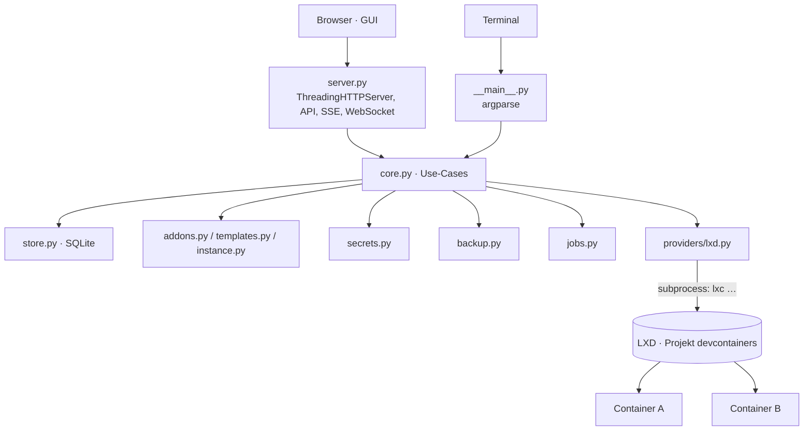

# SPEC – devc, Dev-Container-Manager (LXD)

2026-10-10 · Alexander Ramm

---

## 1. Zweck und Geltungsbereich

devc ist ein einzelnes Python-Programm, das auf einem Linux-Host isolierte Dev-Container für Coding-Agents (Claude Code CLI, opencode CLI) in LXD anlegt, konfiguriert, sichert und über CLI und Web-GUI bedienbar macht.

**Geltung.** Diese Spec beschreibt Version 1.0 mit dem LXD-Provider. Der Apple-Provider (apple/container auf macOS) ist ausgegrenzt; die Provider-Schnittstelle (Abschnitt 8.2) ist so geschnitten, dass er später ohne Änderung am Kern ergänzt werden kann.

**Verhältnis zu anderen Dokumenten.**

- Die GUI-Mockups liegen unter `build/gui/`. Wo sie von dieser Spec abweichen, gilt diese Spec.
- Die Anleitung für Nutzer ist `docs/ANLEITUNG.md`.

**Normative Wörter.** **MUSS / DARF NICHT**: ohne Ausnahme, ein Verstoß ist ein Fehler. **SOLL**: Abweichung nur mit Begründung im Code-Kommentar. **DARF**: erlaubt, nicht verlangt.

**Lesehinweis.** Menschen lesen 1–4 und 13. Die KI MUSS vor jeder Arbeit 3–9, 11 und 14 lesen und vor Änderungen an Tests auch 12.

**Sprache.** Prosa, GUI-Texte und Meldungen auf Deutsch. Bezeichner, Dateinamen, TOML-Schlüssel, Fehlercodes, API-Pfade und Log-Felder auf Englisch.

---

## 2. Grundprinzipien

1. **Nur Standardbibliothek.** devc MUSS mit Python ≥ 3.11 und ausschließlich der Standardbibliothek laufen. Einzige Ausnahme: `xterm.js` als mitgelieferte Datei für die GUI (Abschnitt 8.7).
2. **Ein Kern, zwei Oberflächen.** CLI und HTTP-Server rufen dieselben Use-Cases in `core`. Die CLI MUSS ohne laufenden Server vollständig funktionieren.
3. **Container sind Wegwerfware.** Ein Container entsteht reproduzierbar aus Image, Addons und `devc.toml`. Nicht reproduzierbare Daten liegen in zwei eigenen Datenbereichen (Code und Home).
4. **Keine Verschachtelung.** Dev-Container sind Geschwister auf dem Host.
5. **Engine über CLI.** devc steuert LXD ausschließlich über das Programm `lxc` per `subprocess` mit Argumentlisten.
6. **TOML für Menschen, JSON für Maschinen.** Alles, was Menschen bearbeiten, ist TOML. API-Antworten und interne Zustände sind JSON bzw. SQLite.
7. **Keine Firewall, keine Signaturen.** Bewusst nicht enthalten.

---

## 3. Begriffe

| Begriff | Bedeutung | Datei/Ort |
|---|---|---|
| Host | Linux-Rechner mit LXD, auf dem devc läuft | – |
| Dev-Container, Container | Ein von devc verwalteter LXD-Container im Projekt `devcontainers` | LXD |
| Instanz-Konfiguration | Die `devc.toml` eines Containers; einzige Quelle der Wahrheit für seinen Soll-Zustand | `~/.local/share/devc/containers/<name>/devc.toml` |
| Addon | Verzeichnis, das ein Werkzeug in einen Container bringt | `addons/<id>/` |
| Addon-Aktion | In `addon.toml` hinterlegter Befehl, den devc auf Anforderung im Container ausführt | `[[actions]]` |
| Addon-Link | In `addon.toml` hinterlegte URL, die die GUI im Browser öffnet | `[[links]]` |
| Template | Einzelne TOML-Datei mit fertiger Konfiguration als Vorlage für Instanzen | `~/.config/devc/templates/<id>.toml` |
| Entwurf | Aus einem Template erzeugte, noch nicht angelegte `devc.toml` | im Speicher bzw. Temp-Datei |
| Secret-Slot | Benannter Platz für ein Secret in einem Container: `<addon>.<param>` oder `git.key` | – |
| Store-Eintrag | Geteiltes Secret auf dem Host, über seinen Namen referenziert | `~/.config/devc/secrets/_shared/<name>` |
| Datenbereich Code | Inhalt von `/work` im Container | LXD-Volume `devc-<name>-work` oder Shared Folder |
| Datenbereich Home | Inhalt von `/home/dev` im Container, inkl. Agent-Memory (`~/.claude`, `~/.config/opencode`) | LXD-Volume `devc-<name>-home` |
| Shared Folder | Host-Ordner, der statt des Code-Volumes als `/work` eingehängt wird | Host-Pfad unter `allowed_roots` |
| Agent-Doku | Von devc erzeugte `CLAUDE.md`, `AGENTS.md` und das Infoverzeichnis `.devc/` in `/work` | `/work/…` |
| Snapshot | Zeitpunkt der Datenbereiche auf demselben Host | LXD-Volume-Snapshot bzw. tar |
| Backup | Portables Archiv eines Containers | `~/.local/share/devc/backups/*.devc.tar` |
| Job | Lang laufende Operation mit eigener ID und Log | SQLite + `logs/<job-id>.log` |
| Provider | Modul, das die Engine kapselt (v1: nur `lxd`) | `devc/providers/` |
| Nutzer | Mensch, der devc bedient | – |
| dev | Linux-Nutzer im Container (UID/GID 1000) | Container |
| Prüfung L*n* | Statische Regel aus Abschnitt 9 | – |
| Fachlicher Fehler | Vom Nutzer behebbarer Fehler (Eingabe, Konflikt, Validierung) | Exit-Codes 2, 4, 5, 6 |
| Technischer Fehler | Fehler der Engine oder von devc selbst | Exit-Codes 1, 3 |

---

## 4. Überblick

**CLI und Server teilen einen Kern; nur der Provider kennt LXD.**



| Wer | darf | darf nicht |
|---|---|---|
| `__main__.py`, `server.py` | `core` aufrufen, Ein-/Ausgabe formatieren | `lxc` aufrufen, Dateien unter `~/.config/devc` direkt schreiben |
| `core` | alle Module außer `server`/`__main__` nutzen | Ausgabe auf stdout schreiben (nur über Rückgabewerte, Events, Logger) |
| `providers/lxd.py` | `lxc` per `subprocess.run([...])` aufrufen | `shell=True` verwenden, Container außerhalb des Projekts `devcontainers` ansprechen |
| Addon-Skripte | im Container als root laufen | auf dem Host laufen |
| GUI (`web/`) | ausschließlich die HTTP-API nutzen | eigene Zustände außer UI-Einstellungen speichern |

---

## 5. Ablage, Namen, Adressierung

### 5.1 Quelltext-Verzeichnis (Repository)

```
devc/                         # Repository-Wurzel
  devc/                       # Python-Paket
    __init__.py               # __version__ = "1.0.0"
    __main__.py               # argparse, Einstieg CLI und serve
    errors.py                 # DevcError + Unterklassen, Codes, Exit-Codes
    config.py                 # config.toml laden, Defaults, L1
    paths.py                  # alle Host-Pfade an einer Stelle
    names.py                  # Regex-Prüfungen L2
    tomlw.py                  # TOML-Writer (Teilmenge, Abschnitt 7.1)
    placeholders.py           # Platzhalter-Ersetzung (Abschnitt 7.3)
    addons.py                 # laden, prüfen (L3–L8), requires auflösen
    templates.py              # laden, prüfen (L9), Entwurf (7.4)
    instance.py               # devc.toml prüfen (L10–L12), Unterschiede
    agentdocs.py              # CLAUDE.md, AGENTS.md, Infoverzeichnis .devc/
    secrets.py                # Store, Slots, Push in den Container
    backup.py                 # Snapshot, Backup, Restore
    actions.py                # Addon-Aktionen und Links
    tiles.py                  # Kacheln aus Addons (Abschnitt 8.13)
    vm.py                     # VM: beschränktes Terminal und Update (Abschnitt 8.14)
    jobs.py                   # Job-Runner, Log, Events
    locks.py                  # Container-Locks (fcntl)
    store.py                  # SQLite
    security.py               # Token, Sessions, Bind-Regeln, Pfadprüfung
    core.py                   # Use-Cases (eine Funktion je CLI-Befehl)
    server.py                 # HTTP-API, SSE, statische GUI
    terminal.py               # WebSocket (RFC 6455) + PTY
    chat.py                   # Unterhaltungen für Kacheln der Art chat (Abschnitt 8.13)
    providers/
      __init__.py             # get_provider(config)
      base.py                 # Schnittstelle (Abschnitt 8.2)
      lxd.py                  # LXD-Implementierung
    web/
      index.html              # GUI-Gerüst
      app.js                  # Routing und Seiten, Vanilla JS
      app.css
      vendor/xterm.js         # mitgeliefert, MIT (Abschnitt 8.7)
      vendor/xterm.css
    help/
      user.md, technical.md, ai.md  # Hilfetexte der App (Kopien aus docs/, Abschnitt 8.12)
    builtin/
      addons/<id>/…           # mitgelieferte Addons (aus examples/addons)
      templates/<id>.toml     # mitgelieferte Templates
  tests/                      # unittest (Abschnitt 12)
  build.py                    # erzeugt dist/devc.pyz per zipapp
  vm/                         # devc in einer eigenen VM (seit 1.1): install.sh, cloud-init.yaml, make-user-data.py, README.md
  build/                      # Bau-Unterlagen: Spec, Mockups, Hilfsskripte
  docs/ANLEITUNG.md           # Handbuch für Nutzer (Hilfethema technical)
  docs/HILFE.md               # Erste Schritte in einfacher Sprache (Hilfethema user)
  docs/KI.md                  # Anweisungen für KI-Agenten (Hilfethema ai)
  docs/BAUEN.md               # Bauen in einfacher Sprache (kein Hilfethema)
  examples/                   # Beispiel-Addons, -Templates, -Config (Quelle von devc/builtin)
  README.md
```

### 5.2 Host-Pfade zur Laufzeit

```
~/.config/devc/
  config.toml                 # Konfiguration (6.1)
  token                       # API-Token, 0600
  addons/<id>/                # eigene Addons
  templates/<id>.toml         # eigene Templates
  secrets/                    # 0700
    _shared/<name>            # Store-Einträge, 0600
    <container>/<slot>        # Secrets eines Containers, 0600
~/.local/share/devc/
  devc.sqlite                 # Zustand (6.6)
  containers/<name>/devc.toml # Instanz-Konfiguration
  containers/<name>/applied.toml # zuletzt angewendeter Stand, Grundlage für `config apply`
  logs/<job-id>.log           # Job-Logs
  snapshots/<name>/<snap>/    # tar-Snapshots (nur Shared Folder)
  backups/<datei>.devc.tar    # Backups
  locks/<name>.lock           # Container-Locks
```

Alle Pfade MÜSSEN aus `paths.py` kommen. `XDG_CONFIG_HOME` und `XDG_DATA_HOME` SOLLEN beachtet werden. `paths` aus `config.toml` überschreiben einzelne Orte.

### 5.3 Pfade im Container

| Pfad | Inhalt | Besitzer, Modus |
|---|---|---|
| `/work` | Datenbereich Code | dev, 0755 |
| `/home/dev` | Datenbereich Home | dev, 0750 |
| `/run/devc/` | Laufzeit, bei jedem Start neu | dev, 0700 |
| `/run/devc/secrets/<slot>` | Secret-Dateien | dev, 0400 |
| `/run/devc/actions/<addon>-<id>.pid` und `.log` | Hintergrund-Aktionen | dev, 0600 |
| `/opt/devc/addons/<id>/` | Kopie des Addons bei Installation | root, 0755 |
| `/etc/devc/addons.toml` | installierte Addons mit Version (von devc geschrieben) | root, 0644 |
| `/etc/profile.d/devc-<id>.sh` | Umgebung je Addon (vom Addon geschrieben) | root, 0644 |

### 5.4 Namen

| Was | Muster | Max | Beispiel |
|---|---|---|---|
| Container | `^[a-z][a-z0-9-]{1,30}$`, endet nicht auf `-` | 31 | `py-tools` |
| Addon-ID, Template-ID | `^[a-z][a-z0-9-]{1,30}$` | 31 | `claude-code` |
| Parameter, Aktions-ID | `^[a-z][a-z0-9_]{0,31}$` | 32 | `sap_client` |
| Store-Name | `^[a-z][a-z0-9_-]{0,63}$` | 64 | `git-deploy` |
| Secret-Slot | `<addon-id>.<param>` oder `git.key` | 64 | `abap.sap_password` |
| Snapshot | `^[a-z0-9][a-z0-9-]{0,62}$` | 63 | `vor-refactoring` |
| Automatischer Snapshot | `auto-YYYYMMDD-HHMMSS` (Ortszeit) | – | `auto-20261010-091200` |
| Backup-Datei | `<name>-<YYYYMMDD-HHMMSS>[-<label>].devc.tar` | – | `py-tools-20261009-030000.devc.tar` |
| Job-ID | `j-` + 12 Hex-Zeichen | 14 | `j-4f1a09c2b7de` |
| Version (devc, Addon, Template) | `^\d+\.\d+\.\d+$` | – | `1.0.0` |
| LXD-Volumes | `devc-<name>-work`, `devc-<name>-home` | – | `devc-py-tools-home` |
| Basisdomain (`server.base_domain`) | DNS-Name: Labels `[a-z0-9]([a-z0-9-]{0,61}[a-z0-9])?`, mit `.` verbunden | 215 | `acme.dev.example.com` |
| Name hinter dem Proxy | `devc.<base_domain>` für GUI und API; `<port>-<container>.<base_domain>` für Container-Ports (das erste Label hat höchstens 37 Zeichen und passt in ein DNS-Label) | 253 | `3000-py-tools.acme.dev.example.com` |

Eindeutigkeit: Container-Namen eindeutig im LXD-Projekt; Addon-IDs eindeutig nach Auflösung (eigen überschreibt mitgeliefert); Template-IDs ebenso; Store-Namen eindeutig im Store; Snapshot-Namen eindeutig je Container.

### 5.5 Adressierung

- Ein Container wird über seinen Namen angesprochen, immer im LXD-Projekt aus `lxd.project` (Standard `devcontainers`).
- Ein Template wird in der Instanz als `"<id>@<version>"` vermerkt. Das ist nur Herkunftsangabe; es gibt keine automatische Aktualisierung.
- Eine Aktion wird als `<addon-id>.<aktions-id>` angesprochen, z. B. `httpserver.start`.
- Waisen: Dateien unter `containers/<name>/`, deren Container in LXD fehlt, meldet `devc doctor` als Warnung W3. devc löscht sie nicht selbst.

---

## 6. Schema und Datenmodell

Alle Dateien sind TOML 1.0, UTF-8. Unbekannte Schlüssel sind ein Fehler (Prüfungen L1, L3, L9, L10), damit Tippfehler nicht still ignoriert werden.

### 6.1 config.toml

```toml
platform = "auto"
allowed_roots = ["/srv/dev"]

[server]
bind = "127.0.0.1"
port = 8740
allowed_hosts = ["localhost", "127.0.0.1"]
terminal = true
tls_cert = ""
tls_key = ""
base_domain = ""
public_port = 443
behind_proxy = false

[defaults]
image = "ubuntu:24.04"
cpu = 4
memory = "8GiB"
disk = "30GiB"
addons = ["claude-code"]

[lxd]
project = "devcontainers"
storage_pool = "default"
network = "lxdbr0"
shared_mode = "idmap"

[paths]
addons = "~/.config/devc/addons"
templates = "~/.config/devc/templates"
secrets = "~/.config/devc/secrets"
state = "~/.local/share/devc"
backups = "~/.local/share/devc/backups"
```

| Feld | Pflicht | Bedeutung |
|---|---|---|
| `platform` | nein, Standard `"auto"` | `"auto"` oder `"lxd"`. `auto` wählt `lxd`, wenn `lxc` im PATH ist; sonst Fehler `E_ENGINE`. |
| `allowed_roots` | nein, Standard `[]` | Absolute Host-Pfade, unter denen Shared Folders liegen dürfen. Leer = Shared Folders verboten. |
| `server.bind` | nein, `"127.0.0.1"` | Bind-Adresse (Abschnitt 11.2). |
| `server.port` | nein, `8740` | 1–65535. |
| `server.allowed_hosts` | nein, `["localhost","127.0.0.1"]` | Erlaubte `Host`-Header bei Loopback-Bind (ohne Port). |
| `server.terminal` | nein, `true` | Web-Terminal anbieten. |
| `server.tls_cert`, `server.tls_key` | nein, `""` | PEM-Dateien; beide gesetzt = TLS an. Mit `behind_proxy` sind es die Dateien des Proxys: `devc proxy config` trägt sie ins Caddyfile ein (8.11), devc selbst macht dann kein TLS und liest sie nicht. |
| `server.base_domain` | nein, `""` | Basisdomain des Proxys, z. B. `acme.dev.example.com` oder `localhost`. DNS-Name in Kleinbuchstaben ohne Schema und Port, höchstens 215 Zeichen. GUI und API liegen unter `devc.<base_domain>`. Leer = kein Proxy, Verhalten wie 1.0. |
| `server.public_port` | nein, `443` | 1–65535. Von außen sichtbarer Port des Proxys; devc hängt ihn an erzeugte Adressen an, wenn er nicht 443 ist. |
| `server.behind_proxy` | nein, `false` | `true` = devc läuft hinter einem Proxy auf demselben Rechner (11.2). Verlangt `base_domain` und einen Loopback-Bind; `tls_cert`/`tls_key` beide gesetzt oder beide leer. |
| `defaults.image` | nein, `"ubuntu:24.04"` | LXD-Image-Alias inkl. Remote. |
| `defaults.cpu` | nein, `4` | Ganzzahl ≥ 1 → `limits.cpu`. |
| `defaults.memory`, `defaults.disk` | nein, `"8GiB"`, `"30GiB"` | Größe, Muster `^\d+(MiB|GiB|TiB)$`. |
| `defaults.addons` | nein, `["claude-code"]` | Addons, die bei Anlage ohne Template ergänzt werden. |
| `lxd.project` | nein, `"devcontainers"` | LXD-Projekt. |
| `lxd.storage_pool` | nein, `"default"` | Pool für Root-Disk und Volumes. |
| `lxd.network` | nein, `"lxdbr0"` | Netzwerk für `eth0`. |
| `lxd.shared_mode` | nein, `"idmap"` | `"idmap"` (`raw.idmap "both <host-uid> 1000"`) oder `"shift"` (Disk-Device mit `shift=true`). `shift` lehnt LXD in einem eingeschränkten Projekt für Host-Pfade ab; es bleibt nur für Projekte ohne `restricted.devices.disk.paths`. |
| `paths.*` | nein, siehe 5.2 | Überschreibt einzelne Orte; `~` wird expandiert. |

Fehlt `config.toml`, gelten alle Defaults. `devc init` schreibt die Datei mit allen Defaults.

### 6.2 addon.toml

```toml
id = "httpserver"
title = "HTTP-Server"
version = "1.0.0"
description = "Einfacher HTTP-Server für Dateien aus /work"
platforms = ["lxd", "apple"]
requires = ["base", "python"]
conflicts = []
install = ["install.sh"]
uninstall = []

[[params]]
name = "port"
type = "int"
default = 8000
min = 1024
max = 65535
description = "Port im Container"

[[files]]
src = "files/index.html"
dest = "/work/out/index.html"
mode = "0644"
owner = "dev"
overwrite = false

[[actions]]
id = "start"
label = "Server starten"
run = "python3 -m http.server {port} --directory {dir}"
detach = true

[[actions]]
id = "stop"
label = "Server stoppen"
stops = "start"

[[links]]
label = "Im Browser öffnen"
port = "{port}"
when = "start"

[[tiles]]
id = "status"
title = "Server-Status"
kind = "view"
run = "bash /opt/devc/addons/httpserver/status.sh {port}"
refresh = 5
```

**Kopf**

| Feld | Pflicht | Bedeutung |
|---|---|---|
| `id` | ja | Muster 5.4; MUSS dem Verzeichnisnamen entsprechen. |
| `title` | ja | Anzeigename, 1–60 Zeichen. |
| `version` | ja | Semver `x.y.z`. |
| `description` | nein, `""` | Ein Satz, max. 200 Zeichen. |
| `platforms` | nein, `["lxd","apple"]` | Unterstützte Provider. |
| `requires` | nein, `[]` | Addon-IDs, die vorher installiert sein müssen. `base` wird immer implizit vorangestellt (außer bei `base` selbst). |
| `conflicts` | nein, `[]` | Addon-IDs, die nicht gleichzeitig aktiv sein dürfen. |
| `install` | nein, `[]` | Skripte relativ zum Addon-Verzeichnis, in dieser Reihenfolge. |
| `uninstall` | nein, `[]` | Skripte für `devc uninstall`. Leer = Entfernen nur durch Neuanlage. |

**`[[params]]`**

| Feld | Pflicht | Bedeutung |
|---|---|---|
| `name` | ja | Muster 5.4, eindeutig im Addon. |
| `type` | ja | `string`, `int`, `bool`, `choice`, `secret`, `ports` (seit 1.1, Format 7.8). |
| `default` | nein, kein Default | Wert passend zu `type`. Bei `secret` verboten. |
| `required` | nein, `false` | `true` = Instanz MUSS einen Wert setzen, falls kein `default`. Bei `secret`: Slot MUSS befüllt sein. |
| `options` | bei `choice` ja | Liste von Strings, ≥ 1. |
| `min`, `max` | nein | Nur bei `int`, inklusive Grenzen. |
| `max_length` | nein, `1024` | Nur bei `string`. |
| `pattern` | nein | Nur bei `string`: regulärer Ausdruck (Python `re`, höchstens 500 Zeichen), dem der ganze Wert entsprechen MUSS. Geprüft beim Setzen des Werts, nicht erst im Container. |
| `description` | nein, `""` | Für GUI und README. In der GUI steht er als kurzer Hinweis unter dem Feld: eine Zeile, die ausführliche Erklärung gehört ins README. |
| `label` | nein | Beschriftung in der GUI (1–40 Zeichen), zum Beispiel »Abo-Token«. Der `name` steht klein daneben. |
| `group` | nein | Überschrift (1–40 Zeichen). Parameter mit derselben Gruppe stehen zusammen in einem Kasten, in der Reihenfolge ihres ersten Auftretens; Parameter ohne Gruppe stehen davor. |
| `show_if` | nein | `name=wert` oder `name=wert1\|wert2`: Die GUI zeigt den Parameter nur, wenn der Parameter `name` (ein anderer, vom Typ `choice` oder `bool`, dort `true`/`false`) einen dieser Werte hat. Ein `choice`, auf den ein `show_if` zeigt, erscheint als Knöpfe zur Auswahl. Der Wert bleibt erhalten und geht weiter an `install.sh`; das Skript entscheidet, was gilt. Ein Kasten ohne sichtbaren Parameter entfällt. |
| `option_labels` | nein | Nur bei `choice`: je Option ein Text für die GUI (1–40 Zeichen), gleiche Länge wie `options`. |
| `hidden` | nein, `false` | Die GUI zeigt den Parameter nicht (für alte Parameter, die nur noch gelesen werden). CLI und `devc.toml` kennen ihn weiter. |

Diese fünf Felder wirken nur auf die Darstellung. Verstöße meldet L6.

**`[[files]]`**

| Feld | Pflicht | Bedeutung |
|---|---|---|
| `src` | ja | Datei relativ zum Addon-Verzeichnis, ohne `..`. |
| `dest` | ja | Absoluter Pfad im Container. |
| `mode` | nein, `"0644"` | Oktal als String. |
| `owner` | nein, `"dev"` | `dev` oder `root`. |
| `overwrite` | nein, `true` | `false` = vorhandene Datei bleibt. |

**`[[archives]]`**

| Feld | Pflicht | Bedeutung |
|---|---|---|
| `src` | ja | `.tar.gz` relativ zum Addon-Verzeichnis. |
| `dest` | ja | Absolutes Zielverzeichnis; wird angelegt. Entpackt als root. |

**`[[actions]]`**

| Feld | Pflicht | Bedeutung |
|---|---|---|
| `id` | ja | Muster 5.4, eindeutig im Addon. |
| `label` | ja | Knopftext, 1–40 Zeichen. |
| `run` | eins von `run`/`stops` | Befehlsvorlage (Abschnitt 7.3). |
| `stops` | eins von `run`/`stops` | ID einer Aktion mit `detach = true` im selben Addon. |
| `detach` | nein, `false` | Nur mit `run`. `true` = läuft im Hintergrund, PID wird gemerkt. |
| `user` | nein, `"dev"` | `dev` oder `root`. |
| `timeout` | nein, `300` | Sekunden für nicht abgekoppelte Aktionen, 1–3600. |
| `description` | nein, `""` | Tooltip in der GUI. |

**`[[links]]`**

| Feld | Pflicht | Bedeutung |
|---|---|---|
| `label` | ja | Knopftext, 1–40 Zeichen. |
| `port` | eins von `port`/`ports`/`url` | Port eines Dienstes im Container (seit 1.1): Ganzzahl 1024–65535 oder genau ein Platzhalter eines `int`-Parameters, z. B. `"{port}"`. Der Dienst MUSS auf `0.0.0.0` lauschen. |
| `ports` | eins von `port`/`ports`/`url` | Genau ein Platzhalter eines `ports`-Parameters, z. B. `"{ports}"` (seit 1.1). Ergibt einen Link je Eintrag (7.8); `label` ist dann der Vorsatz für Einträge ohne eigene Beschriftung. |
| `path` | nein, `"/"` | Nur mit `port` oder `ports`. Pfad-Vorlage mit Platzhaltern; beginnt mit genau einem `/`, ohne Leerzeichen. |
| `url` | eins von `port`/`ports`/`url` | URL-Vorlage mit Platzhaltern; MUSS mit `http://` oder `https://` beginnen. |
| `public` | nein, `false` | Nur mit `port` oder `ports` (seit 1.1). `true` = der Proxy leitet Anfragen an diesen Port **ohne Anmeldung** weiter (8.11). Gedacht für APIs, deren Aufrufer den Anmeldeweg nicht mitmachen. |
| `when` | nein, `""` | Aktions-ID mit `detach`; Link nur aktiv, wenn diese läuft. |

Adresse eines Links mit `port` oder `ports`: Ist `server.base_domain` gesetzt, `https://<port>-<container>.<base_domain>[:<public_port>]<path>` (8.11); liegt der Port außerhalb 1024–65535, gibt es keine Adresse und der Link ist inaktiv. Ohne `base_domain` ist es `http://<container_ip>:<port><path>` und damit nur vom Host aus erreichbar. Ein Link mit `url` wird immer wie angegeben angezeigt.

**`[[tiles]]`** (seit 1.1) – Kacheln auf dem Container-Dashboard, Verhalten in 8.13

| Feld | Pflicht | Bedeutung |
|---|---|---|
| `id` | ja | Muster 5.4 (wie Aktions-ID), eindeutig im Addon. Adressiert als `<addon>.<id>`. |
| `title` | ja | Titel der Kachel und der Seite, 1–40 Zeichen. |
| `kind` | ja | `view` (Seite aus der Ausgabe eines Befehls), `chat` (Unterhaltung mit einem Programm im Container), `panel` (bedienbare Seite aus Daten eines Befehls) oder `link` (eigene Oberfläche des Addons). |
| `description` | nein, `""` | Text auf der Kachel, einzeilig, max. 200 Zeichen. |
| `run` | bei `view`, `chat` und `panel` ja | Befehlsvorlage (7.3, Werte mit `shlex.quote`). Läuft als `dev` in `/work` mit `bash -lc`. Bei `link` verboten. |
| `timeout` | nein, `10` | `view`: Sekunden, 1–60. `panel`: Standard `30`, 1–300. |
| `refresh` | nein, `0` | Nur `view`. Die Seite lädt alle so viele Sekunden neu; `0` = nie, sonst 2–3600. |
| `port`, `path` | bei `link` eins von `port`/`url` | Wie bei `[[links]]`: `port` ist eine Ganzzahl 1024–65535 oder genau ein Platzhalter eines `int`-Parameters; `path` (Standard `"/"`) nur mit `port`. |
| `url` | bei `link` eins von `port`/`url` | URL-Vorlage, beginnt mit `http://` oder `https://`. |

**Pflichtdateien** im Addon-Verzeichnis: `addon.toml`, `README.md` (Hilfe für Menschen, in der GUI angezeigt), `AI.md` (Abschnitt für die Agent-Doku). `AI.md` DARF Platzhalter `{param}` enthalten (Abschnitt 7.3, ohne Secrets).

### 6.3 Template (`<id>.toml`)

```toml
id = "abapdev"
title = "ABAP-Entwicklung"
version = "1.0.0"
description = "ABAP mit Claude Code und opencode gegen das S/4-Entwicklungssystem"
platforms = ["lxd", "apple"]
image = "ubuntu:24.04"
addons = ["claude-code", "opencode", "node", "abap"]

[resources]
cpu = 4
memory = "8GiB"
disk = "30GiB"

[data]
code = "volume"

[params.base]
git_name = "[NAME]"

[secrets]
"claude-code.api_key" = "anthropic"

[git]
remote = "ssh://git@[GIT-HOST]/${name}.git"

[[files]]
dest = "/work/.abaplint.json"
overwrite = false
content = '''
{"global": {"files": "/src/**/*.*"}}
'''

[docs]
readme = """…"""
ai = """…"""
```

| Feld | Pflicht | Bedeutung |
|---|---|---|
| `id` | ja | Muster 5.4; MUSS dem Dateinamen ohne `.toml` entsprechen. |
| `title` | ja | Anzeigename, 1–60 Zeichen. **Einzeilig.** |
| `version` | ja | Semver. **Einzeilig.** |
| `description` | nein, `""` | **Einzeilig.** |
| `platforms` | nein, `["lxd","apple"]` | **Einzeilig.** |
| `image` | nein, `defaults.image` | LXD-Image. |
| `addons` | nein, `[]` | Addon-IDs; `base` wird implizit ergänzt. |
| `resources.cpu` / `.memory` / `.disk` | nein, aus `defaults` | Wie 6.1. |
| `data.code` | eins von `code`/`shared` | Nur Wert `"volume"`. |
| `data.shared` | eins von `code`/`shared` | Absoluter Host-Pfad, Platzhalter `${name}` erlaubt. |
| `params.<addon>.<param>` | nein | Werte für Addon-Parameter; Typ passend zur `addon.toml`. Keine `secret`-Parameter. |
| `secrets."<slot>"` | nein | Slot → Store-Name. |
| `git.remote` | nein, `""` | SSH- oder HTTPS-URL. Leer = kein Remote. |
| `[[files]].dest` | ja | Absoluter Pfad unter `/work` oder `/home/dev`. |
| `[[files]].content` | ja | Dateiinhalt als Text. |
| `[[files]].mode` / `.overwrite` | nein, `"0644"` / `true` | Wie 6.2. |
| `docs.readme` | nein, `""` | Markdown für den Nutzer, steht am Anfang von `.devc/README.md` und erscheint in der GUI. |
| `docs.ai` | nein, `""` | Markdown, wird nach den Addon-`AI.md` in die Agent-Doku eingefügt. |

Die mit **Einzeilig** markierten Kopf-Schlüssel MÜSSEN als `key = value` auf einer Zeile stehen, damit der Entwurf (7.4) sie textuell entfernen kann.

### 6.4 Instanz-Konfiguration (`devc.toml`)

Gleiches Schema wie 6.3 mit diesen Unterschieden:

| Feld | Pflicht | Bedeutung |
|---|---|---|
| `name` | ja | Containername, Muster 5.4. |
| `template` | nein, `""` | Herkunft `"<id>@<version>"`, nur Information. |
| `platform` | nein, `"lxd"` | Genau ein Provider. |
| `id`, `title`, `version`, `description`, `platforms` | – | DÜRFEN NICHT vorkommen (L10). |

Alle anderen Felder wie 6.3. Platzhalter `${name}` und `${workdir}` sind in einer Instanz bereits aufgelöst; verbleibende `${…}` sind ein Fehler (L10).

### 6.5 Agent-Doku

devc schreibt in `/work/CLAUDE.md` einen Block zwischen den Zeilen `<!-- devc:begin -->` und `<!-- devc:end -->`:

1. `# Dev-Container <name>` und eine Liste: Plattform, Image, Template, Arbeitsverzeichnis `/work`, Shared Folder (falls), Git-Remote (falls, ohne Zugangsdaten).
2. Abschnitt `## Addons in diesem Container` (seit 1.1): je aktivem Addon eine Zeile `` `<id>` <version> – <description> → `.devc/addons/<id>.md` `` und der Hinweis, die Datei eines Addons vor der Benutzung zu lesen, mit Verweis auf `.devc/README.md` und `.devc/config.toml`. Das ist der Wegweiser: Ohne ihn weiß ein Agent nicht, welche Addons es gibt und wo ihre Anleitung liegt.
3. Je aktivem Addon in Installationsreihenfolge der Inhalt von `AI.md` mit ersetzten Platzhaltern.
4. `docs.ai` der Instanz, falls nicht leer.
5. Abschnitt `## Regeln` mit genau diesen Punkten: »Keine Secrets ins Repository.« · »Secrets liegen nur unter /run/devc/secrets/.« · »Addon-Aktionen werden vom Nutzer über devc gestartet, nicht selbst nachgebaut.«

Text außerhalb der Marker bleibt unverändert. Fehlt die Datei, entsteht sie nur mit dem Block. Fehlt ein Marker oder ist die Reihenfolge falsch, bricht devc mit `E_VALIDATION` ab und ändert nichts.

`/work/AGENTS.md` ist ein relativer Symlink auf `CLAUDE.md`. Existiert `AGENTS.md` als reguläre Datei, bleibt sie unangetastet und devc meldet Warnung W4.

**Infoverzeichnis `/work/.devc/`** (seit 1.1 ausgebaut). Die KI im Container erfährt daraus, welche Addons es gibt und wie sie funktionieren. Der Ordner gehört vollständig devc und entsteht bei jedem `create`, `config apply` und `devc docs` neu:

| Datei | Inhalt |
|---|---|
| `README.md` | `docs.readme` der Instanz, dann die Übersicht: Angaben zum Container (wie im Block, dazu die Adresse im Netz der Container), Tabelle »Aktive Addons« (in Installationsreihenfolge) und »Weitere Addons« (alle übrigen des Katalogs für die Plattform, mit dem Befehl zum Ergänzen), jeweils mit Verweis auf die Seite des Addons; Tabelle »Secrets« mit Slot, Zustand und Pfad. |
| `addons/<id>.md` | Eine Seite je Addon des Katalogs: Version, Stand (aktiv oder nicht, dann mit `devc install <name> <id>`), `requires`; Einstellungen mit den wirksamen Werten (bei nicht aktiven Addons die Standardwerte); Aktionen mit dem eingesetzten Befehl und der Art; Links; Kacheln; `AI.md` mit ersetzten Platzhaltern; `README.md` vollständig. Seiten von Addons, die es im Katalog nicht mehr gibt, entfernt devc. |
| `config.toml` | Kopie der `devc.toml` des Containers mit einem Kopfkommentar. Nur zur Information; Änderungen dort wirken nicht. |

Geheimnisse stehen dort nie: Secret-Parameter erscheinen nur als »gesetzt« mit dem Pfad `/run/devc/secrets/<slot>` oder als »nicht gesetzt«; in `config.toml` sind die Werte unter `[secrets]` (Namen im Store) durch `"***"` ersetzt; Zugangsdaten in `http(s)`-Adressen werden überall zu `***@`. Ein Platzhalter ohne Wert (nicht aktives Addon) bleibt als Text stehen. Wird ein Secret eines laufenden Containers gesetzt oder entfernt, schreibt devc `README.md` und die Seite des betroffenen Addons sofort neu; scheitert das, bleibt die Änderung am Secret gültig. Sonst sind die Seiten so aktuell wie die letzte Anwendung: Nach einer Änderung am Katalog bringt `devc docs <name>` sie auf den Stand.

### 6.6 SQLite (`devc.sqlite`)

```sql
CREATE TABLE containers (
  name TEXT PRIMARY KEY,
  platform TEXT NOT NULL,
  created_at TEXT NOT NULL,        -- ISO 8601 UTC
  applied_at TEXT,                 -- letzte erfolgreiche Anwendung
  addons_json TEXT NOT NULL        -- {"<id>": "<version>", ...}
);
CREATE TABLE jobs (
  id TEXT PRIMARY KEY,
  container TEXT,                  -- NULL bei globalen Jobs
  kind TEXT NOT NULL,              -- create, apply, action, snapshot, backup, restore, delete, addon-import
  state TEXT NOT NULL,             -- queued, running, ok, failed
  error_code TEXT,
  started_at TEXT, finished_at TEXT
);
CREATE TABLE snapshots (
  container TEXT NOT NULL, name TEXT NOT NULL,
  created_at TEXT NOT NULL, scope TEXT NOT NULL, -- data | full
  PRIMARY KEY (container, name)
);
CREATE TABLE action_runs (
  container TEXT NOT NULL, action TEXT NOT NULL, -- <addon>.<id>
  started_at TEXT NOT NULL, pid INTEGER
);
CREATE TABLE schema_version (v INTEGER NOT NULL);
```

LXD ist die Wahrheit über Existenz und Laufstatus. `devc list` gleicht bei jedem Aufruf mit `lxc list --format json` ab und markiert Einträge ohne Container als `missing`.

---

## 7. Formate und Ausdrücke

### 7.1 TOML lesen und schreiben

- Lesen MUSS mit `tomllib` erfolgen.
- Vom Nutzer bearbeitete Dateien (Template, Instanz, Config) werden als **Text** gespeichert, nachdem `tomllib.loads` und die zugehörigen Prüfungen erfolgreich waren. Kommentare bleiben erhalten.
- `tomlw.dumps(dict) -> str` schreibt neue Dateien. Unterstützt: `str` (Basic Strings mit Escapes, ab Zeilenumbruch als `"""…"""`), `int`, `bool`, Listen aus Skalaren, verschachtelte Tabellen, Listen von Tabellen (`[[x]]`). Nicht unterstützt: Floats, Datumswerte, Inline-Tabellen; Aufruf damit → `ValueError`.
- `tomlw` MUSS die Eigenschaft `tomllib.loads(tomlw.dumps(d)) == d` für alle unterstützten Werte erfüllen (Test T-TOML).

### 7.2 Größen

`^\d+(MiB|GiB|TiB)$`. Umrechnung für LXD: unverändert als String übergeben (`limits.memory=8GiB`, Root-Disk `size=30GiB`).

### 7.3 Platzhalter in Aktionen, Links und AI.md

```
vorlage     = { text | platzhalter | escape }
platzhalter = "{" name "}"
name        = [a-z] [a-z0-9_]{0,31}
escape      = "{{" | "}}"
```

- `{name}` wird ersetzt durch: den Wert des gleichnamigen Parameters **desselben Addons** aus der Instanz (sonst dessen `default`), oder eine der Systemgrößen `container`, `container_ip`, `workdir` (`/work`), `user` (`dev`).
- Kollidiert ein Parametername mit einer Systemgröße, ist das ein Fehler (L7).
- `{{` und `}}` ergeben `{` und `}`.
- Unbekannter Name, fehlender Wert ohne Default oder ein Parameter vom Typ `secret` → Fehler (L7, L8).
- **In `run`**: jeder eingesetzte Wert wird mit `shlex.quote` maskiert. `bool` ergibt `true`/`false`, `int` die Dezimalzahl.
- **In `url` und `path`** eines Links: Werte werden mit `urllib.parse.quote(value, safe="")` eingesetzt, außer `container_ip`. `port` eines Links ist keine Vorlage, sondern eine Zahl oder genau ein Platzhalter (6.2).
- **In `AI.md`**: Werte unverändert eingesetzt.
- `container_ip` ist die erste IPv4-Adresse mit `scope == "global"` auf `eth0` aus `lxc list <name> --format json`. Fehlt sie (Container gestoppt), ist eine Aktion mit `{container_ip}` nicht ausführbar (`E_CONFLICT`, Meldung »Container läuft nicht«).

`${name}` und `${workdir}` (mit Dollar) sind **Template**-Platzhalter und werden nur beim Entwurf (7.4) ersetzt; sie sind von `{…}` getrennt.

### 7.4 Entwurf aus Template

Eingabe: Template-Text, Containername. Ausgabe: Text einer `devc.toml`.

1. Template mit `tomllib` laden und L9 prüfen.
2. Zeilenweise: alle Zeilen **vor der ersten Tabellen-Kopfzeile** (`^\s*\[`) entfernen, deren Schlüssel `id`, `title`, `version`, `description` oder `platforms` ist (`^\s*(id|title|version|description|platforms)\s*=`).
3. An den Anfang setzen:
   ```
   # Entwurf aus <id>@<version> – gilt nur für diese Instanz
   name = "<name>"
   template = "<id>@<version>"
   platform = "lxd"
   ```
4. Im ganzen Text `${name}` durch den Containernamen und `${workdir}` durch `/work` ersetzen.
5. Ergebnis mit `tomllib` laden und L10 prüfen (ohne L10.5 Eindeutigkeit, die prüft erst `create`).

Ohne Template: Entwurf mit `tomlw.dumps` aus `name`, `platform`, `image`, `addons = defaults.addons`, `[resources]` aus `defaults`, `[data] code = "volume"`.

### 7.5 Zusammenführen von CLI-Optionen

Reihenfolge, spätere gewinnt: Addon-Defaults → Template → `--param`/`--secret`/`--shared`/… der CLI bzw. die im GUI bearbeitete `devc.toml`. `--addon` ergänzt die Liste (keine Duplikate, Reihenfolge stabil). `--from <datei>` schließt `--template` aus (`E_USAGE`).

### 7.6 Auflösung von Addons und Templates

1. Eigene unter `paths.addons` bzw. `paths.templates`.
2. Mitgelieferte aus `devc/builtin/`.

Gleiche ID in beiden: eigene gewinnt, `addon list` zeigt `Herkunft: eigen (überschreibt mitgeliefert)`. Doppelte ID innerhalb einer Quelle ist unmöglich (Verzeichnis- bzw. Dateiname).

### 7.7 requires-Auflösung

Topologische Sortierung über `requires` der aktiven Addons plus `base` als erstes. Fehlende Abhängigkeit wird **nicht** automatisch ergänzt, sondern ist Fehler L5 mit Hinweis »Addon <x> benötigt <y>«. Ausnahme: `base`. Bei gleichem Rang gilt die Reihenfolge der `addons`-Liste.

### 7.7a Addon `packages`: Pakete ohne eigenes Addon

Für Pakete von Ubuntu, die kein eigenes Addon haben (zum Beispiel die Bibliotheken für den Browser von Playwright), gibt es das mitgelieferte Addon `packages`.

- Parameter `apt` (`string`, bis 4000 Zeichen): Paketnamen, durch Leerzeichen getrennt. Ein `pattern` lässt nur Namen zu (`[a-z0-9][a-z0-9+.-]+`), keine Optionen, Versionen, Pfade oder Shell-Zeichen. `install.sh` prüft jeden Namen noch einmal und ruft `apt-get install -y -- <namen>` mit einzelnen Argumenten auf. Es läuft kein freier Text als root.
- Parameter `recommends` (`bool`, Standard `false`): ohne ihn `--no-install-recommends`.
- Eine geänderte Liste richtet `config apply` wie jeden geänderten Parameter ein (ohne Neustart). Ein Paket aus der Liste zu nehmen entfernt es nicht (Never-Do: nichts automatisch löschen); es fehlt nach der Neuanlage.
- Grundsatz: Ein eigenes Addon lohnt sich, wenn devc etwas davon wissen muss (Kachel, Port, Secret, Aktion). Reine Pakete gehören in diese Liste. Ein Einrichtungs-Skript je Container (freie Befehle als root) ist besprochen, aber nicht beauftragt.

### 7.8 Parametertyp `ports` (seit 1.1)

```
wert         = [ eintrag { leerraum eintrag } ]
eintrag      = port [ "=" beschriftung ]
port         = Dezimalzahl ohne führende Null, 1024 bis 65535
beschriftung = 1 bis 40 druckbare Zeichen ohne Leerraum und ohne "="
```

- Der Wert ist ein String; der leere String ist gültig und bedeutet »kein Port«. Höchstens 32 Einträge, kein Port doppelt. Verstöße meldet die Prüfung des Parameters (L6 für den Default, L9/L10 für Werte in Template und Instanz).
- Ein Link mit `ports = "{name}"` (6.2) ergibt je Eintrag einen Link in der Reihenfolge der Angabe. Beschriftung des Links: die des Eintrags, sonst `<label> <port>`. `path` und `when` gelten für alle.
- In `run`, `url`, `path` und `AI.md` verhält sich ein `ports`-Parameter wie ein String.
- Das mitgelieferte Addon `webproxy` hat zwei Parameter dieses Typs mit je einem Link: `proxy` (mit Anmeldung) und `public` (Link mit `public = true`, ohne Anmeldung). Es installiert nichts. Die Freigabe des Proxys hängt nicht davon ab: Erreichbar ist jeder Port ab 1024 (8.11); das Addon liefert die Links dazu.

---

## 8. Laufzeit und Schnittstellen

### 8.1 Fehler und Exit-Codes

| Code | Exit | HTTP | Klasse | Wann |
|---|---|---|---|---|
| `E_INTERNAL` | 1 | 500 | technisch | Unerwarteter Fehler in devc |
| `E_JOB_FAILED` | 1 | 500 | technisch | Ein Job-Schritt schlug fehl (z. B. `install.sh` Exit ≠ 0) |
| `E_USAGE` | 2 | 400 | fachlich | Falsche Argumente, unvereinbare Optionen |
| `E_ENGINE` | 3 | 502 | technisch | `lxc` fehlt, nicht erreichbar oder meldet Fehler |
| `E_NOT_FOUND` | 4 | 404 | fachlich | Container, Addon, Template, Snapshot, Backup, Store-Eintrag, Aktion fehlt |
| `E_CONFLICT` | 5 | 409 | fachlich | Name belegt, Container gesperrt (busy), Addon in Benutzung, Container läuft nicht |
| `E_VALIDATION` | 5 | 422 | fachlich | Eine Prüfung L*n* schlägt fehl |
| `E_MISSING_SECRET` | 5 | 422 | fachlich | Secret-Slot ohne Wert, nicht interaktiv |
| `E_SECURITY` | 6 | 403 | fachlich | Pfad außerhalb Allowlist, unsicherer Bind, Terminal nicht freigegeben |
| `E_AUTH` | – | 401 | fachlich | Kein oder falsches Token/Session (nur HTTP) |

Fehlerobjekt (API und `--json`):

```json
{"error": "E_VALIDATION", "message": "Addon abap benötigt node", "details": {"check": "L5", "path": "addons"}}
```

| Feld | Pflicht | Bedeutung |
|---|---|---|
| `error` | ja | Code aus der Tabelle. |
| `message` | ja | Deutscher Satz für Menschen. |
| `details` | nein, `{}` | Maschinenlesbare Zusatzinfos; bei Prüfungen `check`, optional `path`, `line`. Bei `E_MISSING_SECRET`: `slots` (Liste). Bei `E_JOB_FAILED`: `job`. |

Ohne `--json` schreibt die CLI `Fehler [E_CODE]: <message>` nach stderr. Mehrere Prüfbefunde: eine Zeile je Befund `L5 addons: Addon abap benötigt node`, danach Exit 5.

### 8.2 Provider-Schnittstelle

`providers/base.py` definiert eine abstrakte Klasse `Provider`. Alle Methoden werfen bei Engine-Problemen `EngineError` (→ `E_ENGINE`), bei fehlendem Objekt `NotFoundError`.

| Methode | Eingabe | Ausgabe | Effekt |
|---|---|---|---|
| `check()` | – | `list[Finding]` | keine; für `doctor` |
| `init_project()` | – | – | Projekt, Profil, Restriktionen anlegen (idempotent) |
| `list()` | – | `list[ContainerState]` | keine |
| `state(name)` | Name | `ContainerState` (`name, status, ip, created`) | keine |
| `create(spec)` | `CreateSpec` (Name, Image, Ressourcen, Datenbereiche) | – | Container + Volumes anlegen, nicht starten |
| `start(name)` / `stop(name, timeout=30)` | Name | – | Lebenszyklus |
| `delete(name, keep_data)` | Name, bool | – | Container löschen, Volumes nur bei `keep_data=False` |
| `exec(name, argv, user, cwd, env, stdin=None, timeout=None)` | | `ExecResult(rc, stdout, stderr)` | Befehl im Container |
| `exec_stream(name, argv, user, cwd, env, on_line)` | | `rc` | wie `exec`, Zeilen live |
| `exec_pty(name, argv, user, cwd)` | | `(pid, master_fd)` | interaktive Sitzung |
| `exec_pipe(name, argv, user, cwd)` | | `subprocess.Popen` | lang laufender Befehl mit Pipes (stdin, stdout als Bytes, stderr in stdout), für Kacheln der Art `chat` (8.13) |
| `push(name, host_path, dest, mode, uid, gid)` | | – | Datei in Container |
| `pull(name, src, host_path)` | | – | Datei aus Container |
| `set_limits(name, cpu, memory, disk)` | | – | Ressourcen setzen |
| `volume_snapshot(name, area, snap)` / `volume_restore(…)` / `volume_snapshot_delete(…)` | `area` ∈ `work`, `home` | – | Volume-Snapshots |
| `full_snapshot(name, snap)` / `full_restore(…)` | | – | Container-Snapshot |

### 8.3 LXD-Abbildung

Alle `lxc`-Aufrufe tragen `--project <lxd.project>`.

| Vorgang | Aufruf (Argumentliste) |
|---|---|
| Projekt anlegen | `lxc project create devcontainers -c features.images=false -c features.profiles=true -c features.storage.volumes=true -c features.networks=false -c restricted=true -c restricted.snapshots=allow -c restricted.devices.disk=allow -c restricted.devices.disk.paths=<allowed_roots,kommagetrennt>`. Ist `allowed_roots` leer, stattdessen `-c restricted.devices.disk=managed` ohne `restricted.devices.disk.paths` (ein leerer Pfadwert würde in LXD alle Host-Pfade erlauben). `devc init` gleicht diese Schlüssel bei bestehendem Projekt an (bei `shared_mode=idmap` zusätzlich `restricted.idmap.uid=<host-uid> restricted.idmap.gid=<host-gid>`) |
| Profil `default` im Projekt | Root-Disk `root disk path=/ pool=<pool>`, Netz `eth0 nic network=<network> name=eth0` |
| Volumes | `lxc storage volume create <pool> devc-<name>-work`, `… devc-<name>-home` |
| Container anlegen | `lxc init <image> <name> -c limits.cpu=<n> -c limits.memory=<m> -d root,size=<disk>` |
| Volumes einhängen | `lxc config device add <name> work disk pool=<pool> source=devc-<name>-work path=/work` und `home … path=/home/dev` |
| Shared Folder | `lxc config device add <name> work disk source=<host-pfad> path=/work shift=true`; bei `idmap`: ohne `shift`, dazu `lxc config set <name> raw.idmap "both <host-uid> 1000"` |
| Exec | `lxc exec <name> --user <uid> --group <gid> --cwd <cwd> --env HOME=<home> --env K=V … -- <argv…>` |
| PTY | `lxc exec <name> -t …` an einem `pty.openpty()`-Paar |
| IP | `lxc list <name> --format json` |
| Volume-Snapshot | `lxc storage volume snapshot <pool> devc-<name>-<area> <snap>` |
| Volume-Restore | Container stoppen, `lxc storage volume restore <pool> devc-<name>-<area> <snap>`, starten |
| Voll-Snapshot | Container stoppen, `lxc snapshot <name> <snap>`, starten; Restore ebenso mit `lxc restore <name> <snap>` |
| Löschen | `lxc delete <name> --force`; Volumes `lxc storage volume delete <pool> devc-<name>-<area>` nur ohne `--keep-data` |

devc MUSS nur Container verwalten, für die ein Eintrag in `containers` existiert. Fremde Container im Projekt erscheinen in `list` mit Status `foreign` und sind für alle ändernden Befehle gesperrt (`E_CONFLICT`).

### 8.4 Abläufe

**create** (Job `create`, Container-Lock)

1. Entwurf/Instanz erzeugen und zusammenführen (7.4, 7.5).
2. Prüfungen L2, L5–L12, L15. Fehlende Secrets: CLI fragt verdeckt (`getpass`) nach; mit `--yes` oder über API → `E_MISSING_SECRET`.
3. `devc.toml` nach `containers/<name>/devc.toml` schreiben (Text), Eintrag in `containers`.
4. Provider: Volumes, Container, Devices, Limits anlegen; starten.
5. Laufzeitverzeichnisse anlegen: `install -d -o 1000 -g 1000 -m 0700 /run/devc /run/devc/secrets /run/devc/actions` (als root).
6. Secrets pushen (11.3).
7. Für jedes Addon in Reihenfolge 7.7: Addon-Verzeichnis nach `/opt/devc/addons/<id>/` kopieren; `[[archives]]` entpacken; `install`-Skripte als root mit `bash -euo pipefail <skript>` und Umgebung 8.5 ausführen; `[[files]]` schreiben; Version in `/etc/devc/addons.toml` und `containers.addons_json` vermerken.
8. `[[files]]` der Instanz schreiben.
9. Git: falls `git.remote`, als dev `git config --global` setzen und `~/.ssh/config` mit `IdentityFile /run/devc/secrets/git.key` für den Host des Remotes schreiben. Kein `git init`, kein Push.
10. Agent-Doku erzeugen (6.5).
11. `applied_at` setzen. Job `ok`.

Bricht ein Schritt ab, bleibt der Container bestehen (keine Transaktion), Job `failed`, Container-Status in der GUI »unvollständig« (`incomplete`). Solange bei einem unvollständigen Container noch eine Operation den Lock hält, liefern Liste und Info zusätzlich `installing: true`; CLI und GUI zeigen dann »wird eingerichtet« statt »unvollständig« und bieten »Anwenden« nicht als Abhilfe an. `devc config apply` setzt an Schritt 7 wieder auf. `devc rm` räumt auf.

**start** (Schnellaktion): `lxc start`, dann Schritte 5–6 von create. **stop**: `lxc stop` (Timeout 30 s, danach `--force`). **restart**: stop + start.

**config apply** (Job `apply`): neue `devc.toml` prüfen; Unterschiede ermitteln (Addons hinzu/entfernt, Parameter je Addon, Ressourcen, Daten, Git, Files, Docs). Datenbereich-Änderungen (`data.*`) sind in v1 nicht anwendbar → `E_VALIDATION` mit Hinweis auf Backup/Restore. Ablauf: Ressourcen setzen; entfernte Addons mit `uninstall` ausführen, ohne `uninstall` → `E_VALIDATION`; neue Addons installieren; Addons mit geänderten Parametern oder neuer Version erneut installieren (alle `install`-Skripte MÜSSEN idempotent sein); Secrets pushen; Files; Git; Agent-Doku; `devc.toml` speichern; `applied_at`. Für jedes Addon, das wegen geänderter Parameter oder neuer Version neu installiert wird: seine laufenden `detach`-Aktionen vor der Installation stoppen und danach mit den neuen Parametern starten (Fehlschlag des Starts: Warnung im Job, kein Abbruch). Der Container wird dabei nicht neu gestartet; andere Prozesse bleiben. **config set** (`params_set`): Parameter aktiver Addons als `<addon>.<param>=<wert>` in die `devc.toml` schreiben (Addon nicht aktiv: `E_NOT_FOUND`), dann `config apply`.

**action run** (Job `action`, kein Container-Lock außer bei `detach`-Start/Stopp):

- `run` ohne `detach`: `exec` als `user` in `/work` mit `bash -lc <befehl>`, Timeout `timeout`, Ausgabe ins Job-Log, Exit ≠ 0 → `E_JOB_FAILED`.
- `run` mit `detach`: läuft die Aktion schon (PID lebt), → `E_CONFLICT`. Sonst `bash -lc 'setsid nohup bash -lc <befehl> > /run/devc/actions/<a>-<id>.log 2>&1 & echo $! > /run/devc/actions/<a>-<id>.pid'`.
- `stops`: PID aus Datei lesen; `kill -TERM -<pid>` (Prozessgruppe); 5 s warten; ggf. `kill -KILL -<pid>`; PID-Datei löschen. Läuft nichts → Erfolg mit Meldung »lief nicht«.
- Status einer `detach`-Aktion: `running`, wenn die PID-Datei existiert und `kill -0 <pid>` 0 liefert, sonst `stopped`.

### 8.5 Umgebung für install-Skripte

| Variable | Wert |
|---|---|
| `DEVC_CONTAINER` | Containername |
| `DEVC_ADDON` | Addon-ID |
| `DEVC_ADDON_DIR` | `/opt/devc/addons/<id>` |
| `DEVC_WORKDIR` | `/work` |
| `DEVC_USER` | `dev` |
| `DEVC_PARAM_<NAME>` | Wert jedes Nicht-Secret-Parameters, `<NAME>` in Großbuchstaben; `bool` als `true`/`false` |
| `DEVC_SECRET_<NAME>` | **Pfad** der Secret-Datei (`/run/devc/secrets/<addon>.<name>`), nie der Wert; nur gesetzt, wenn befüllt |
| `DEBIAN_FRONTEND` | `noninteractive` |

Skripte DÜRFEN Dateien unter `/etc/profile.d/devc-<id>.sh` schreiben, um Umgebung für Login-Shells bereitzustellen.

### 8.6 HTTP-API

- Basis `/api`, JSON in und out (UTF-8). Ausnahmen: Datei-Up/Downloads (Rohdaten), TOML-Texte (`text/plain; charset=utf-8`), SSE, WebSocket.
- Lange Operationen antworten `202` mit `{"job": "<id>"}`.
- Statische GUI unter `/`, Dateien aus `devc/web/` (aus dem Paket bzw. zipapp via `importlib.resources`).

| Methode und Pfad | Body / Antwort | CLI |
|---|---|---|
| `POST /api/login` | `{"token"}` → `204` + Cookie | – |
| `POST /api/logout` | → `204` | – |
| `GET /api/status` | `{version, platform, bind, insecure, behind_proxy, terminal, terminal_allowed}` | – |
| `GET /api/addons` · `GET /api/addons/{id}` | Liste · Details inkl. README | `addon list/show` |
| `PUT /api/addons` | Archiv (.tar.gz/.zip) → `201 {id, version}` | `addon import` |
| `GET /api/addons/{id}/archive` | `application/gzip` | `addon export` |
| `DELETE /api/addons/{id}` | → `204` | `addon rm` |
| `GET /api/templates` · `GET /api/templates/{id}` | Liste · `{meta, text}` | `template list/show` |
| `PUT /api/templates/{id}` | TOML-Text → `200 {findings}` | `template edit` |
| `DELETE /api/templates/{id}` | → `204` (nur eigene) | `template rm` |
| `POST /api/drafts` | `{template, name}` → `{text}` | Entwurf |
| `POST /api/validate/instance` | TOML-Text → `{findings, missing_secrets}` | – |
| `GET /api/containers` · `GET /api/containers/{name}` | Liste · Details | `list` · `info` |
| `POST /api/containers` | TOML-Text der `devc.toml` → `202` | `create` |
| `POST /api/containers/{name}/start` · `/stop` · `/restart` | → `200 {status}` | Lebenszyklus |
| `DELETE /api/containers/{name}?keep_data=1` | → `202` | `rm` |
| `GET` · `PUT /api/containers/{name}/config` | TOML-Text | `config show/edit` |
| `POST /api/containers/{name}/config/apply` | → `202` | `config apply` |
| `POST /api/containers/{name}/addons` `{addons: [id], params: {id: {name: wert}}, secrets: {slot: wert}}` | Addons in der `devc.toml` ergänzen, Parameter setzen und anwenden → Job; `params` und `secrets` sind freiwillig. `secrets` füllt Slots der neuen Addons (lokaler Wert), nach dem Speichern der Konfiguration und vor dem Einrichten; ein Slot, der kein Secret dieser Addons ist, ist `E_USAGE`, bevor sich etwas ändert | `install` (ohne Secrets; dort danach `secret set`) |
| `GET /api/containers/{name}/addons` | aktive Addons mit README, Aktionen (inkl. Status), Links (aufgelöst: `{label, url, active}`, bei Links mit `port` zusätzlich `port` und `path`) | `action list` |
| `PUT /api/containers/{name}/addons/{id}/params` `{params: {name: wert}}` | Parameter eines aktiven Addons setzen und anwenden → Job | `config set` |
| `POST /api/containers/{name}/actions/{addon}.{id}` | → `202` | `action run` |
| `GET /api/containers/{name}/tiles` | `{name, running, tiles: [{ref, addon, id, title, kind, description, active}]}`; bei `view` zusätzlich `refresh`, bei `link` `url` (und `port`, `path`) (8.13) | `tile list` |
| `GET /api/containers/{name}/tiles/{addon}.{id}/view` | Kachel der Art `view` ausführen → `{name, tile, title, refresh, text, truncated}` | `tile show` |
| `POST /api/containers/{name}/tiles/{addon}.{id}/panel` `{view, args}` oder `{action, args, values}` | Kachel der Art `panel`: Ansicht → `{name, tile, title, note, blocks}`; Aktion → `{name, tile, title, ok, message, output, view?}` (8.13) | `tile panel` |
| `GET /api/containers/{name}/chats` | `{sessions: [{id, tile, title, created, attached, state, session, busy_for}]}` (8.13); `busy_for`: Sekunden, seit der Agent arbeitet, sonst `null` | – |
| `GET /api/containers/{name}/chats/history?tile=<addon>.<id>` | frühere Unterhaltungen laut Bridge → `{sessions: [{id, title, updated}]}` | – |
| `GET /api/containers/{name}/chats/transcript?tile=<addon>.<id>&session=<kennung>` | Verlauf einer früheren Unterhaltung zum Ansehen → `{name, tile, session, events}`; startet nichts | – |
| `GET /api/containers/{name}/chats/stats?tile=<addon>.<id>&session=<kennung>` | Statistik einer Unterhaltung → `{name, tile, session, text}` (`text` ist Markdown der Bridge); startet nichts | – |
| `POST /api/containers/{name}/chats` | `{"tile", "resume"?}` → `201` mit der Unterhaltung; eine je Kachel, höchstens 4 je Container, sonst `E_CONFLICT` | – |
| `DELETE /api/containers/{name}/chats/{id}` | beendet die Unterhaltung (die Bridge darf noch aufräumen, 8.13) | – |
| `GET /api/containers/{name}/chat?session=<id>` | WebSocket zu einer laufenden Unterhaltung | – |
| `GET /api/vm` | `{terminal, update, allowed, commands, user, version, build}` (8.14); `terminal` und `update` sind nur wahr, wenn eingerichtet und erlaubt | `vm info` |
| `GET` · `POST /api/vm/terminals` · `DELETE /api/vm/terminals/{id}` · `GET /api/vm/terminal?session=<id>` | Sitzungen des VM-Terminals und ihr WebSocket, wie beim Web-Terminal (8.7, 8.14) | `vm shell` |
| `POST /api/vm/update` | Body: das neue `devc.pyz` → `202 {from, to, started}` (8.14) | `vm update` |
| `GET /api/containers/{name}/terminals` | `{sessions: [{id, number, user, created, attached}]}` | – |
| `POST /api/containers/{name}/terminals` | `{"user": "dev"\|"root"}` → `201` mit der Sitzung; höchstens 8 je Container, sonst `E_CONFLICT` | – |
| `DELETE /api/containers/{name}/terminals/{id}` | beendet die Sitzung | – |
| `GET /api/containers/{name}/terminal?session=<id>` | WebSocket zu einer bestehenden Sitzung | – |
| `GET /api/containers/{name}/secrets` | Slots mit Quelle und Status, nie Werte | `secret list` |
| `PUT /api/containers/{name}/secrets/{slot}` | `{"value"}` oder `{"store": "<name>"}` → `204` | `secret set` |
| `DELETE /api/containers/{name}/secrets/{slot}` | → `204` | `secret rm` |
| `GET /api/secrets` | Namen, Nutzung, Änderungsdatum | `secret list --shared` |
| `PUT /api/secrets/{name}` | Rohwert (Body) → `204` | `secret set --shared` |
| `DELETE /api/secrets/{name}` | → `204` | `secret rm --shared` |
| `GET` · `POST /api/containers/{name}/snapshots` | `{label?, full?}` → `202` | `snapshot list/create` |
| `POST /api/containers/{name}/snapshots/{snap}/restore` | → `202` | `snapshot restore` |
| `DELETE /api/containers/{name}/snapshots/{snap}` | → `204` | `snapshot rm` |
| `GET /api/containers/{name}/backups` | Liste | – |
| `POST /api/containers/{name}/backups` | `{label?, include_home?, include_work?}` → `202` | `backup` |
| `GET` · `DELETE /api/backups/{datei}` | Download · Löschen | – |
| `POST /api/restore/inspect` | Archiv (Body) oder `{"backup": "<datei>"}` → `{upload_id?, devc_toml, checks}` | – |
| `POST /api/restore` | `{source: {backup}|{upload_id}, target: "replace"|"new", name?, devc_toml}` → `202` | `restore` |
| `GET /api/containers/{name}/files?path=/work/src` | Verzeichnisliste | – |
| `GET /api/containers/{name}/files/raw?path=…` | Datei bzw. Verzeichnis als tar.gz | `pull` |
| `PUT /api/containers/{name}/files/raw?path=…` | Rohdaten → `204` | `push` |
| `DELETE /api/containers/{name}/files/raw?path=…` | Datei oder Ordner (rekursiv) löschen → `204`; `/work` selbst: `E_USAGE` | `file rm` |
| `GET /api/containers/{name}/files/archive?path=…` | Vorschau eines tar-/zip-Archivs: `format`, `count`, `size`, `top`, `entries` (höchstens 500), `truncated`, `skipped` | `file archive` |
| `POST /api/containers/{name}/files/unpack` `{path, into?}` | Archiv entpacken → `{into, files, dirs, links, skipped}` | `file unpack` |
| `GET /api/jobs?container=` · `GET /api/jobs/{id}` | Liste · Details. In der Liste trägt ein Job im Zustand `running` das Feld `active`: `true`, solange der Lock seines Containers belegt ist; `false` heißt, der Job ist liegen geblieben | `jobs` |
| `GET /api/jobs/{id}/events` | SSE | `jobs --follow` |
| `GET /api/help` · `GET /api/help/{id}` | `{topics: [{id, title, summary}]}` · `{id, title, summary, text}` (Markdown) | `help list/show` |
| `GET /api/proxy/auth` | nur für den Proxy (8.11) → `200` mit `X-Devc-Upstream`, `302`, `401`, `403` oder `404` | – |
| `GET /api/proxy/login?to=<adresse>` | Anmeldeweg eines Container-Ports (8.11) → `302` | – |
| `GET /api/proxy/config?http_port=<port>` | Caddyfile als Text | `proxy config` |

**Auth.** Jede Anfrage außer `GET /`, statischen Dateien, `POST /api/login` und den beiden Proxy-Pfaden `GET /api/proxy/auth` und `GET /api/proxy/login` (sie prüfen Cookie bzw. Ticket selbst, 8.11) MUSS authentifiziert sein: `Authorization: Bearer <token>` oder Session-Cookie `devc_session`. Ändernde Anfragen mit Cookie MÜSSEN `X-Devc: 1` tragen, sonst `E_AUTH`. Sessions liegen nur im Speicher, gültig 12 Stunden; Cookie `HttpOnly; SameSite=Strict; Path=/`, bei TLS zusätzlich `Secure` (hinter einem Proxy: wenn dieser `X-Forwarded-Proto: https` meldet). Das Cookie trägt nie ein `Domain=`-Attribut; es gilt nur für den Namen von devc, nicht für Container-Ports unter derselben Basisdomain.

**SSE** (`/api/jobs/{id}/events`): Ereignisse `log` (eine Logzeile als `data`), `state` (`{"state": "...", "error": ...}`), `end` (leer). Ein beendeter Job liefert das gesamte Log, dann `state` und `end`. Während eines langen Schritts kommt zusätzlich `progress` mit dem Stand (8.8) als JSON und `progress` mit `null`, sobald der Schritt vorbei ist.

**Uploads** MÜSSEN `Content-Length` tragen; Grenze 2 GiB, sonst `E_USAGE`. Kein Multipart (das Modul `cgi` fehlt ab Python 3.13).

### 8.7 Web-Terminal

- WebSocket nach RFC 6455 in `terminal.py` (Handshake mit `Sec-WebSocket-Accept`, Text- und Binärframes, Ping/Pong, Close, Fragmentierung beim Empfang). Max. Framegröße 1 MiB.
- Der `Origin`-Header MUSS zum `Host` passen (gleiches Schema, Host, Port), sonst `403`. Hinter einem Proxy (11.2) zählen dafür Schema und Host, die der Proxy meldet.
- Nachrichten vom Browser: Binärframes = Tastatureingabe; Textframe `{"type":"resize","cols":<int>,"rows":<int>}` setzt die Größe per `TIOCSWINSZ`.
- Nachrichten zum Browser: Binärframes mit PTY-Ausgabe.
- Sitzung: `lxc exec <name> -t --user <uid> --cwd /work --env HOME=… --env TERM=xterm-256color -- bash -l`. `user` ∈ `dev`, `root`. `TERM` setzt devc selbst: Der Dienst hat keins, das `lxc` weiterreichen könnte, und ohne `TERM` scheitern `clear`, `top` und `nano`.
- Sitzungen gehören dem Server, nicht der Verbindung: Endet der WebSocket (Neuladen, Seitenwechsel), läuft die Shell weiter. Eine Sitzung endet mit ihrem Prozess (`exit`, Container-Stopp), per `DELETE` oder mit dem Server (auch bei `SIGTERM`); sie liegt nur im Speicher. Beim Beenden bekommt `lxc exec` erst `SIGHUP`, nach 0,5 s `SIGKILL`.
- Beim Verbinden liefert der Server die letzte Ausgabe nach (höchstens 512 KiB je Sitzung). Mehrere Verbindungen zur selben Sitzung sind erlaubt.
- Nach jeder Größenänderung bekommt `lxc exec` ein `SIGWINCH`; das PTY ist nicht sein steuerndes Terminal.
- Die GUI zeigt die Sitzungen eines Containers als Tabs (`<user> <nummer>`) mit Schließen-Kreuz und merkt sich den zuletzt gewählten Tab im Browser.
- Bei Ende des Prozesses Close-Frame 1000. Start und Ende der Sitzung werden als Job-Log-Ereignis vermerkt (`kind=terminal`), ohne Inhalte.
- Verfügbar nur, wenn `server.terminal = true` und der Bind-Modus es erlaubt (11.2), sonst `E_SECURITY`.
- `web/vendor/xterm.js` und `xterm.css` (MIT-Lizenz) werden einmalig bei der Entwicklung abgelegt und mit ausgeliefert, nie von einem CDN geladen. Fehlen die Dateien, zeigt die Terminal-Seite stattdessen den Befehl `devc shell <name>`.

### 8.8 Jobs, Locks, Logging

- Jobs laufen im Server in Threads, in der CLI im Vordergrund mit Live-Ausgabe.
- Container-Lock: `fcntl.flock` auf `locks/<name>.lock`, nicht blockierend. Belegt → `E_CONFLICT` »Container ist beschäftigt«. Gilt für create, apply, start/stop, snapshot, backup, restore, delete, detach-Aktionen.
- Logzeilen: `[HH:MM:SS] <phase> <text>`, z. B. `[09:11:40] addon    python: install.sh ok`. Phasen: `template`, `create`, `mount`, `secrets`, `addon`, `files`, `git`, `docs`, `action`, `snapshot`, `backup`, `restore`, `done`, `error`.
- Secrets-Werte DÜRFEN in keinem Log, keiner Ausnahme und keinem Prozessargument erscheinen.
- Fortschritt (seit 1.1): Lange Schritte melden ihren Stand als `{"label", "done", "total", "percent", "exact"}` (Bytes bisher; `total` und `percent` sind `null`, wenn die Größe unbekannt ist). Der Stand steht nicht im Log, sondern in `logs/<job-id>.progress`, die jede Meldung ersetzt und die mit dem Schritt verschwindet; höchstens zwei Meldungen je Sekunde, dazu jede neue Prozentzahl. Ist `total` geschätzt (`exact = false`), zeigt `percent` höchstens 99. Es melden: Backup je Datenbereich (»Code (/work) sichern«, geschätzt) und Restore je Datenbereich (»… wiederherstellen«, genau). Die GUI zeigt einen Balken unter der Meldung des Jobs; betritt man eine Seite des Containers, während ein Backup oder Restore noch läuft (`active`), erscheinen Meldung und Balken wieder, außer auf Terminal und Log. Die CLI zeigt im Terminal eine Zeile auf stderr, die sich erneuert; mit `--json`, `-q` oder ohne Terminal zeigt die CLI nichts davon.
- Logs älter als 30 Tage löscht `devc doctor --cleanup`. Kein automatisches Löschen.

### 8.9 CLI

Aufruf `devc <befehl>` bzw. `python3 devc.pyz <befehl>`. Globale Optionen: `--config <pfad>`, `--json`, `-v`, `-q`. Mit `--json` gibt jeder Befehl ein JSON-Objekt aus (Erfolg: Ergebnis; Fehler: Fehlerobjekt 8.1 auf stdout, Exit wie Tabelle).

| Befehl | Optionen | Wirkung |
|---|---|---|
| `init` | – | Config, Token, Verzeichnisse, LXD-Projekt (idempotent) |
| `doctor` | `--cleanup` | Prüft Python, `lxc`, Gruppe `lxd`, Projekt, Pool, Netz, `allowed_roots`, Shift-Unterstützung, Waisen, Proxy-Einstellungen (L14) und Caddy, xterm.js |
| `token show` · `token rotate` | – | Token anzeigen bzw. neu erzeugen (beendet alle Sessions) |
| `addon list` · `show <id>` · `validate <dir>` | – | Katalog |
| `addon import <archiv>` · `export <id> [-o datei]` · `rm <id>` | – | Verwaltung eigener Addons |
| `template list` · `show <id>` · `edit <id>` · `validate <datei>` · `save <container> <id>` · `rm <id>` | – | Templates |
| `create <name>` | `--template`, `--edit`, `--from`, `--addon`*, `--param`*, `--secret`*, `--shared`, `--git`, `--image`, `--cpu`, `--memory`, `--disk`, `--no-start`, `--yes` | Container anlegen |
| `list` · `info <name>` | – | Übersicht · Details |
| `start` · `stop` · `restart <name>` | – | Lebenszyklus |
| `rm <name>` | `--keep-data`, `--yes` | Löschen; ohne `--yes` Rückfrage |
| `shell <name>` | `--root` | `os.execvp("lxc", […])` |
| `exec <name> -- <argv…>` | `--root` | Einzelbefehl |
| `install <name> <addon…>` · `uninstall <name> <addon>` | `--param`* | Ändert `addons` in `devc.toml` und wendet an |
| `docs <name>` | – | Agent-Doku neu erzeugen |
| `config show` · `edit` · `apply <name>` | `apply --dry-run` | Instanz-Konfiguration |
| `config set <name> <addon>.<param>=<wert> …` | – | Parameter aktiver Addons setzen und anwenden (Job `apply`) |
| `action list <name>` · `action run <name> <addon>.<id>` | – | Addon-Aktionen |
| `tile list <name>` · `tile show <name> <addon>.<id>` | – | Kacheln aus Addons auflisten · eine Kachel der Art `view` ausführen und ihren Text (Markdown) ausgeben (8.13) |
| `tile panel <name> <addon>.<id>` | `--view <id>` oder `--action <id>`, `--arg <name>=<wert>` (mehrfach), `--value <name>=<wert>` (mehrfach; `true`/`false` für Schalter) | Kachel der Art `panel`: Ansicht holen oder Aktion ausführen; Ausgabe ist das JSON der Antwort (8.13) |
| `vm info` · `vm shell` · `vm update <devc.pyz>` | – | Die VM, in der devc läuft (8.14): was eingerichtet ist und welche Fassung läuft · beschränkte Shell · neues `devc.pyz` einrichten (der Dienst startet neu) |
| `secret set <name> <slot>` | `=@datei`, `=-`, `=shared:<store>` | Secret eines Containers |
| `secret list <name>` · `secret rm <name> <slot>` | – | – |
| `secret set --shared <store>` · `list --shared` · `rm --shared <store>` | `=@datei`, `=-` | Geteilter Store |
| `snapshot create <name>` | `--label`, `--full` | – |
| `snapshot list` · `restore <name> <snap>` · `rm <name> <snap>` | `restore --yes` | – |
| `backup <name>` | `-o <verzeichnis>`, `--label`, `--no-home`, `--no-work` | – |
| `restore <archiv>` | `--name <neu>`, `--replace <name>`, `--edit`, `--yes` | Genau eins von `--name`/`--replace` |
| `push <name> <lokal> [<ziel>]` · `pull <name> <quelle> [<lokal>]` | – | Ziel/Quelle relativ zu `/work` |
| `file rm <name> <pfad> [--yes]` · `file archive <name> <archiv>` · `file unpack <name> <archiv> [--into <ordner>]` | – | Unter `/work` (L13). Entpacken: devc holt das Archiv auf den Host, liest es mit `tarfile`/`zipfile` und schickt dem Container einen bereinigten tar-Strom (`tar -x -C <ziel> --no-same-owner` als `dev`). Übersprungen und gemeldet: absolute Pfade, `..`, symbolische Links mit absolutem Ziel oder Ziel außerhalb, harte Links, Geräte. Grenzen: Archivdatei und entpackte Größe je 1 GiB, 100 000 Einträge; verschlüsseltes zip: `E_USAGE`. Ziel ohne `--into`: Ordner des Archivs. |
| `serve` | `--bind`, `--port`, `--allow-insecure-bind`, `--allow-insecure-terminal`, `--tls-cert`, `--tls-key`, `--dev` | Server |
| `jobs` | `--container`, `--follow <id>` | Jobs |
| `help list` · `help show <thema>` | – | Hilfethemen auflisten · eines als Markdown ausgeben (8.12) |
| `proxy config` | `--http-port <port>` | Gibt das Caddyfile für `server.base_domain` aus (8.11); schreibt nichts nach `/etc` |

`*` = mehrfach angebbar. `--secret <slot>` ohne Wert fragt verdeckt nach; `<slot>=@datei` liest eine Datei; `=-` liest stdin; `=shared:<store>` verweist auf den Store.

### 8.10 GUI

Die GUI ist eine Single-Page-App (`index.html`, `app.js`, `app.css`) mit Hash-Routen. Aufbau, Texte und Regeln folgen den Mockups in `build/gui/` (Entwurf 2). Bei Abweichung zwischen Mockup und dieser Spec gilt die Spec.

Der Titel des Browser-Tabs ist `devc – <Seitentitel>`, auf den Seiten eines Containers `devc [<name>] – <Seitentitel>` (auf seinem Dashboard nur `devc [<name>]`), damit man mehrere Tabs auseinanderhält.

| Route | Mockup | Inhalt |
|---|---|---|
| `#/` | `v2-Dashboard.html` | Container-Tabelle (Start/Stopp als einzige Schnellaktion), Kacheln Templates/Addons/Secret-Store, laufende Jobs |
| `#/new` | `v2-Neu-Template.html` | Schritt 1: Template wählen oder ohne |
| `#/new/edit?template=<id>` | `v2-Neu-Konfig.html` | Schritt 2: Name, Code-Ablage, TOML-Editor des Entwurfs, Live-Prüfung |
| `#/templates` · `#/templates/<id>` | `v2-Templates.html` · `v2-Template-Edit.html` | Liste · TOML-Editor mit Prüfung |
| `#/addons` | `v2-Addons.html` | Liste, Hochladen, Herunterladen, Löschen |
| `#/secrets` | `v2-Secrets.html` | Store-Einträge, Setzen, Entfernen |
| `#/help` · `#/help/<id>` | – (kein Mockup, seit 1.1) | Hilfe (8.12): Reiter je Thema, Text, »Als Markdown kopieren«, »Herunterladen« |
| `#/c/<name>` | `v2-Container.html` | Container-Dashboard: Schnellaktionen-Leiste, Kacheln; nach den festen Kacheln die Kacheln der aktiven Addons (8.13) |
| `#/vm` · `#/vm/update` | – (kein Mockup, seit 1.1) | Terminal der VM · devc aktualisieren (8.14). Die Kachel »VM« auf dem Dashboard gibt es nur, wenn eins von beiden eingerichtet und erlaubt ist. |
| `#/c/<name>/tile/<addon>.<id>` | – (kein Mockup, seit 1.1) | Seite einer Kachel aus einem Addon: Art `view` oder `chat` (8.13) |
| `#/c/<name>/addons` | `v2-C-Addons.html` | Aktive Addons: Aktionen, Links, ein Satz Beschreibung mit Link zur Hilfeseite, darunter die Parameter des Addons als Formular (»Übernehmen« → `PUT …/addons/{id}/params`); Secret-Parameter nur als Verweis auf die Secrets-Seite. Darstellung nach `label`, `group`, `show_if`, `option_labels`, `hidden` (6.2). Ab zwei Addons oben eine Sprungliste »Springen zu:« und je Karte »↑ nach oben« |
| `#/c/<name>/addons/<id>` | – | Hilfe zu einem Addon: README als Markdown, Tabelle der Parameter |
| `#/c/<name>/add-addon` | – | Addon hinzufügen, Schritt 1: alle Addons des Katalogs wie auf `#/addons`, aktive mit Vermerk, sonst »Auswählen«. Erreichbar über »Addon hinzufügen« auf den Seiten Addons und Konfiguration |
| `#/c/<name>/add-addon/<id>` | – | Schritt 2: Parameter des Addons als Formular mit den Standardwerten, darunter das README. »Hinzufügen und einrichten« → `POST …/addons` mit dem Addon, seinen noch fehlenden `requires`, den geänderten Werten und den eingetragenen Secrets. Secret-Parameter sind hier Eingabefelder (Passwort), kein Verweis auf die Secrets-Seite: Den Slot gibt es dort erst nach dem Hinzufügen. Gesperrt, wenn der Container nicht läuft oder ein `conflicts`-Addon aktiv ist |
| `#/c/<name>/terminal` | `v2-Terminal.html` | Web-Terminal |
| `#/c/<name>/files?path=` | `v2-Dateien.html` | Dateibrowser `/work`; Dateinamen führen zum Betrachter. Je Zeile ein Menü »…«: Herunterladen, Entpacken … (nur Archive), Löschen … (mit Rückfrage) |
| `#/c/<name>/unpack?path=` | – | Vorschau vor dem Entpacken: Ziel »Hier« oder »In einen neuen Ordner« (vorgewählt: »Hier«, wenn das Archiv genau einen Ordner enthält), entstehende Pfade der obersten Ebene mit Hinweis auf Vorhandenes, übersprungene Einträge, alle Einträge aufklappbar. Erst »Entpacken« schreibt. |
| `#/c/<name>/file?path=` | – | Betrachter für eine Datei unter `/work`, nur über `GET`/`PUT …/files/raw`. Darstellung nach Inhalt: Bild bei festen Endungen (`png jpg jpeg gif webp svg bmp ico avif`, als `blob:`-URL in ``, Zoom −/100 %/+/Fit, Verschieben mit gedrückter Maustaste), Text bei gültigem UTF-8 ohne NUL bis 2 MiB (umschaltbar auf Markdown, bei `.md`/`.markdown` vorgewählt), sonst Hex (64-KiB-Blöcke). Text und Markdown: Ansicht/Bearbeiten, Speichern per `PUT`; vor dem Speichern Vergleich mit dem Stand im Container, bei Abweichung Rückfrage; CRLF bleibt erhalten. Über 20 MiB nur Herunterladen. Kompakte Seite ohne Titelzeile. CSP dafür: `img-src 'self' data: blob:`. |
| `#/c/<name>/config` | `v2-Konfig.html` | TOML-Editor, Anwenden, Verwerfen, Container löschen |
| `#/c/<name>/secrets` | `v2-C-Secrets.html` | Slots, Setzen aus Store oder lokal |
| `#/c/<name>/log` | `v2-Log.html` | Jobs und Log (SSE) |
| `#/c/<name>/snapshots` | `v2-Snapshots.html` | Liste, Erstellen, Zurücksetzen, Löschen |
| `#/c/<name>/backups` · `/backups/new` · `/restore` | `v2-Backups.html` · `v2-Backup-Neu.html` · `v2-Restore.html` | Backups |

Hinter einem Proxy (`behind_proxy` in `/api/status`, seit 1.1):

- Links mit `port` baut die GUI aus `port` und `path` und der Adresse, unter der sie selbst geladen wurde (Schema und Port bleiben, `devc.` wird durch `<port>-<container>.` ersetzt). So stimmt der Link auch durch einen Tunnel mit anderem Port.
- Für Dienste ohne eigenes Addon gibt es das Addon `webproxy` (7.8); das Dashboard hat dafür kein eigenes Feld.

GUI-Regeln (verbindlich):

1. Kachel = Navigation. Kacheln lösen nie eine Aktion aus.
2. Schnellaktion = genau eine Aktion ohne Eingaben, Ergebnis als Meldung (`role="status"`) direkt unter dem Titel. Nur in der Leiste »Schnellaktionen« des Container-Dashboards (Stoppen/Starten, Neu starten, Shell-Befehl kopieren), als Start/Stopp in der Dashboard-Tabelle und als »Backup jetzt« auf der Seite Backups (Backup mit `/work` und `/home/dev`, ohne Label, ohne Rückfrage). »Snapshot jetzt« gibt es seit 1.1 nicht mehr; Snapshots entstehen auf der Seite Snapshots.
3. Alles mit Eingaben oder mehreren Schritten hat eine eigene Route.
4. Jede Seite: Brotkrumen, Titel, Hauptaktion rechts oben, Meldungen unter dem Titel.
5. Destruktive Aktionen (Löschen, Zurücksetzen, Restore mit `replace`) verlangen eine Bestätigung im Dialog.
6. Bei unsicherem Bind zeigt jede Seite das rote Banner aus den Mockups.
7. Touch-Ziele ≥ 44 px, echte `<button>`/`<a>`/`<label>`, Kontrast ≥ 4,5:1. Funktioniert ab 360 px Breite.
8. Keine externen Ressourcen zur Laufzeit (Schriften lokal oder Systemschriften; die Mockups nutzen Google Fonts nur zur Ansicht).

### 8.11 Container-Ports über den Proxy (seit 1.1)

Gilt nur mit `server.behind_proxy = true`; sonst antworten die Pfade unter `/api/proxy/` (außer `config`) mit `E_NOT_FOUND`.

**Namen.** Ein Dienst im Container ist unter `<port>-<container>.<base_domain>` erreichbar. `<port>` ist eine Dezimalzahl ohne führende Null von 1 bis 65535, `<container>` ein Containername nach 5.4. Jeder andere Name unter der Basisdomain außer `devc` ist `E_NOT_FOUND`. Der Dienst MUSS im Container auf `0.0.0.0` lauschen.

**Caddy.** `devc proxy config` erzeugt das Caddyfile. `devc.<base_domain>` geht an devc. Für alle anderen Namen fragt Caddy per `forward_auth` bei `GET /api/proxy/auth` nach und leitet bei `200` an die Adresse aus dem Antwortkopf `X-Devc-Upstream: <ip>:<port>` weiter (`reverse_proxy {http.request.header.X-Devc-Upstream}`). Vor der Weiterleitung entfernt Caddy diesen Kopf sowie die Cookies `devc_proxy` und `devc_session` aus der Anfrage. `--http-port <port>` ergänzt dieselben Namen unverschlüsselt auf diesem Port; das ist nur für Basisdomains unter `localhost` erlaubt (sonst `E_USAGE`). TLS ist `tls internal` (eigene CA von Caddy); sind `server.tls_cert` und `server.tls_key` gesetzt, steht stattdessen `tls <cert> <key>` im Caddyfile (ein Zertifikat für `*.<base_domain>`, lesbar für den Nutzer `caddy`; Pfade ohne Leerzeichen, Klammern und Anführungszeichen). Antwortet im Container nichts auf dem Port (Fehler 502, 503 oder 504 von Caddy), gibt Caddy statt einer leeren Antwort einen deutschen Satz als `text/plain` aus, der auf den fehlenden Dienst und auf `0.0.0.0` hinweist. Für alles, was unverschlüsselt (Port 80 und `--http-port`) keinen der Namen trifft, vor allem den Aufruf über die IP-Adresse, liefert Caddy eine feste Hinweisseite (HTML, Status 404, `Content-Security-Policy: default-src 'none'; style-src 'unsafe-inline'`): Link zur Oberfläche, bei Basisdomains unter `localhost` die Befehle für SSH-Tunnel und `socat`, sonst der Hinweis auf DNS, dazu `devc token show`. Die Adresse in den Befehlen ist die, auf der die Verbindung ankam (`{http.request.local.host}`); der Host-Kopf der Anfrage erscheint nicht in der Seite. Die Seite enthält keine Geheimnisse.

**`GET /api/proxy/auth`.** Nur von Loopback (sonst `E_SECURITY`). devc liest `X-Forwarded-Host`, `X-Forwarded-Proto`, `X-Forwarded-Method` und `X-Forwarded-Uri` und entscheidet in dieser Reihenfolge:

1. Name passt nicht → `E_NOT_FOUND`. Schema nicht erlaubt (11.2) → `E_SECURITY`.
2. Die Adresse trägt den Parameter `devc_ticket`: Ticket einlösen (gültig → `Set-Cookie: devc_proxy=…`), dann `302` auf dieselbe Adresse ohne den Parameter. Das gilt auch für ein ungültiges Ticket und bei bereits gültigem Cookie; der Parameter erreicht den Container nie.
3. Kein gültiges Cookie `devc_proxy` für diesen Namen und der Port ist nicht ohne Anmeldung freigegeben: bei `GET` und `HEAD` `302` auf `devc.<base_domain>/api/proxy/login?to=<adresse>` (gleiches Schema und gleicher Port wie die Anfrage), sonst `E_AUTH`. Das GUI-Cookie `devc_session` und das Token gelten hier nicht.
4. Port außerhalb 1024–65535 → `E_SECURITY`. Container nicht von devc verwaltet, fehlt oder läuft nicht → `E_NOT_FOUND` (nicht unterscheidbar).
5. Sonst `200` mit `X-Devc-Upstream`. devc DARF das Ziel je Container und Port bis zu 5 Sekunden merken; ein gestoppter Container ist so lange noch erreichbar gemeldet.

**Ports ohne Anmeldung.** Ein Port ist ohne Anmeldung freigegeben, wenn ein aktives Addon des Containers ihn in der gespeicherten `devc.toml` über einen Link mit `public = true` nennt (6.2) und der Container läuft. Dann überspringt devc Schritt 3 für alle Methoden und setzt kein Cookie; die Schritte 2, 4 und 5 gelten unverändert. Jeder, der den Proxy erreicht, erreicht damit den Dienst; ihn zu schützen ist Sache der Anwendung. Lässt sich die Freigabe nicht ermitteln (Container fehlt, läuft nicht, Konfiguration fehlerhaft), gilt der Port als geschützt. Die Auskunft wird wie das Ziel bis zu 5 Sekunden gemerkt. `GET /api/containers/{name}/addons` kennzeichnet solche Links mit `public: true`, die GUI zeigt »ohne Anmeldung erreichbar«.

**`GET /api/proxy/login?to=…`.** Unter `devc.<base_domain>`. `to` MUSS eine Adresse `https://<port>-<container>.<base_domain>[:<port>]/…` sein (`http` nur unter `localhost`), ohne Nutzerangabe, ohne Leer- und Steuerzeichen, ohne `\`, höchstens 2048 Zeichen; sonst `E_USAGE`. Fragment und ein mitgegebenes `devc_ticket` werden entfernt. Ist der Browser bei devc angemeldet, antwortet devc mit `302` auf `to` mit angehängtem `devc_ticket`. Sonst `302` auf `/?to=…`: Die GUI meldet an und ruft danach `/api/proxy/login?to=…` erneut auf.

**Ticket und Cookie.** Ein Ticket ist zufällig (32 Bytes), gilt 30 Sekunden, genau einmal und nur für den Namen, für den es ausgestellt wurde; jedes vorgelegte Ticket ist danach verbraucht. Das Cookie `devc_proxy` (`HttpOnly; SameSite=Lax; Path=/`, bei `https` `Secure`, nie `Domain=`) gilt 12 Stunden und nur für diesen einen Namen; ein anderer Port desselben Containers durchläuft den Anmeldeweg erneut. Tickets und Sitzungen liegen nur im Speicher. `POST /api/logout` beendet alle.

### 8.12 Hilfe in der App (seit 1.1)

devc liefert drei Hilfetexte mit, erreichbar über CLI (`help list`, `help show <thema>`), API und die GUI-Route `#/help` (Eintrag »Hilfe« in der Hauptnavigation).

| Thema | Titel | Quelle | Inhalt |
|---|---|---|---|
| `user` | Erste Schritte | `docs/HILFE.md` | Die Oberfläche in einfacher Sprache, ohne Kommandozeile |
| `technical` | Handbuch | `docs/ANLEITUNG.md` | Alle Befehle, Konfiguration, Addons, Proxy, Fehlercodes |
| `ai` | Für KI-Agenten | `docs/KI.md` | Regeln für einen Agenten, der in einem Container arbeitet oder devc für den Nutzer bedient |

- Gepflegt wird unter `docs/`. `devc/help/<thema>.md` sind Kopien, damit die Texte im Paket und im zipapp liegen; ein Test prüft die Gleichheit. Jede Änderung in beiden Dateien machen.
- Die Texte sind Markdown. `user` und `ai` DÜRFEN NICHT auf `build/` verweisen (Nutzer haben das Verzeichnis nicht). `ai` verwendet die normativen Wörter aus Abschnitt 1.
- Unbekanntes Thema → `E_NOT_FOUND`. Die API verlangt die Anmeldung wie alle anderen Pfade.
- Die GUI zeigt den Text mit einem eigenen kleinen Markdown-Leser in `app.js` (Überschriften, Absätze, Zeilenumbruch durch zwei Leerzeichen am Zeilenende, Listen auch verschachtelt, Tabellen, Code-Blöcke, `Code`, fett, Links auf `http(s)`). Er erzeugt DOM-Knoten und setzt nie HTML ein; andere Markdown-Formen erscheinen als Text. Neue Formen in den Hilfetexten nur zusammen mit dem Leser einführen.
- »Als Markdown kopieren« und »Herunterladen« geben den unveränderten Text aus, damit er sich einem KI-Agenten als Anweisung mitgeben lässt.

### 8.13 Kacheln aus Addons (seit 1.1)

Ein aktives Addon kann mit `[[tiles]]` (6.2) Kacheln auf das Container-Dashboard legen. devc kennt das Programm dahinter nicht. Es gibt vier Arten.

**Grundsatz.** Was aus dem Container kommt, ist nie HTML für die GUI von devc. Ein Addon liefert Daten (Markdown oder Ereignisse), devc zeichnet sie mit festen Bausteinen und setzt sie nur als Text oder über den Markdown-Leser (8.12) ein. Ein Addon mit eigener Oberfläche benutzt die Art `link`; die Oberfläche liegt dann unter der eigenen Adresse des Container-Ports (8.11), getrennt von devc.

**`link`.** Die Kachel öffnet die Adresse in einem neuen Tab. Die Adresse entsteht wie bei `[[links]]` (6.2, 8.10). Läuft der Container nicht oder fehlt die Adresse, ist die Kachel ohne Ziel.

**`view`.** Öffnet die Seite `#/c/<name>/tile/<addon>.<id>`. devc führt `run` im Container aus (`bash -lc`, als `dev`, in `/work`, Zeitgrenze `timeout`); die Standardausgabe ist der Text der Seite als Markdown, höchstens 256 KiB (danach gekürzt, `truncated: true`). Exit ≠ 0 oder Zeitüberschreitung → `E_JOB_FAILED` (die Meldung nennt die letzte Zeile der Fehlerausgabe). Der Container MUSS laufen (`E_CONFLICT`). Mit `refresh > 0` lädt die Seite in diesem Abstand neu, solange sie offen und sichtbar ist. Es entsteht kein Job.

**`panel`** (Beispiel: Addon `git`). Öffnet die Seite `#/c/<name>/tile/<addon>.<id>` mit einer bedienbaren Oberfläche. Das Addon liefert dafür nur Daten; devc zeichnet sie mit festen Bausteinen.

- Für jede Ansicht und jede Aktion führt devc `run` neu aus (`bash -lc`, als `dev`, in `/work`, Zeitgrenze `timeout`) und schreibt die Anfrage als eine JSON-Zeile auf stdin. Eingaben des Nutzers stehen so in keiner Prozessliste und keinem Log. Die Antwort ist ein JSON-Objekt auf stdout, höchstens 1 MiB. Exit ≠ 0, Zeitüberschreitung, kein JSON oder eine Antwort außerhalb des Schemas → `E_JOB_FAILED`.
- Ansicht: Anfrage `{"view": <id|"">, "args": {name: text}}`, Antwort `{"title", "note", "blocks": [...]}`. Die Startansicht hat die ID `""`.
- Aktion: Anfrage `{"action": <id>, "args": {...}, "values": {name: text|bool}}`, Antwort `{"ok": bool, "message", "output", "view": {"view", "args"}}` (`output` und `view` optional). Danach zeigt die GUI `message` und lädt die aktuelle Ansicht neu oder wechselt zu `view`.
- IDs (Ansicht, Aktion, Feld, Schlüssel in `args`): `[a-z0-9][a-z0-9_-]{0,39}`. Grenzen der Anfrage: je 20 Einträge in `args` und `values`, `args`-Werte bis 4096 Zeichen, `values`-Werte bis 64 KiB; sonst `E_USAGE`.
- Bausteine (`type`): `text` (`text` als Markdown), `code` (`text` in fester Schrift), `table` (`columns`, `rows` mit `cells` und `actions`, `empty`), `actions` (`actions`), `form` (`fields`, `submit`); alle mit optionalem `title`. Höchstens 50 Bausteine, 500 Zeilen je Tabelle (danach `truncated`), 12 Spalten, 8 Knöpfe je Zeile oder Reihe, 20 Felder, 256 KiB je Text.
- Knopf: `{"label", "view", "args"}` oder `{"label", "action", "args", "confirm"}`, dazu optional `style` (`primary`, `danger`). `confirm` ist die Rückfrage vor einer Aktion. Feld: `name`, `label`, `type` (`text`, `multiline`, `bool`, `choice` mit `options`), `value`, `required`, `hint`. Ein Feld für Passwörter gibt es mit Absicht nicht; Geheimnisse gehören in ein Secret des Addons.
- devc prüft jede Antwort (`devc/panel.py`) und reicht nur diese Felder an die GUI weiter; Unbekanntes fällt weg, ein unbekannter Baustein ist ein Fehler. Die GUI setzt alles als Text oder über den Markdown-Leser ein.
- Die Ansicht steht in der Adresse der Seite (`?v=<ansicht>&a.<name>=<wert>`); Zurück und Neuladen im Browser funktionieren.
- Das Skript MUSS `args` selbst prüfen (zum Beispiel Pfade): devc kennt ihre Bedeutung nicht.
- Eine Aktion wird als Job-Log-Ereignis vermerkt (`kind=tile`: Kachel, Aktion, Erfolg), ohne `args` und `values`. Ansichten hinterlassen nichts.
- Anders als `chat` ist `panel` nicht an das Web-Terminal gebunden: Es läuft nur der Befehl aus der `addon.toml`, wie bei Aktionen (8.10).

**`chat`.** Öffnet eine Unterhaltung mit einem Programm im Container, der **Bridge** des Addons.

- devc startet `run` mit Pipes (`lxc exec`, ohne PTY, `bash -lc`, als `dev`, in `/work`) und spricht mit der Bridge über stdin und stdout: eine JSON-Zeile (UTF-8) je Nachricht, höchstens 1 MiB je Zeile. Eine Zeile, die kein Ereignis des Protokolls ist, zeigt devc als Fehlermeldung (`error`).
- Die Unterhaltung gehört dem Server, wie eine Terminal-Sitzung (8.7): Sie läuft weiter, wenn kein Browser verbunden ist, und endet mit dem Prozess, per `DELETE` oder mit dem Server. Bei `DELETE` schickt devc der Bridge die Zeile `{"type":"end"}` und schließt ihre Eingabe; sie hat dann 30 s zum Aufräumen (zum Beispiel für einen Titel), danach folgt `SIGTERM`, 2 s später `SIGKILL`. Endet der Server, gibt es kein `end`; die Fristen sind 2 s und 4 s. Sie liegt nur im Speicher. Je Kachel läuft höchstens eine, je Container höchstens 4.
- WebSocket wie in 8.7 (Handshake, `Origin`, Größen). Jedes Ereignis ist ein Textframe. Beim Verbinden liefert der Server den bisherigen Verlauf nach (höchstens 5000 Ereignisse und 8 MiB), dazu den Text einer Antwort, die gerade entsteht. Endet der Prozess, sendet der Server `{"type":"exit","code":<int|null>}` und Close 1000.
- Verfügbar nur, wo auch das Web-Terminal erlaubt ist (11.2), sonst `E_SECURITY`: Ein Chat mit einem Agenten ist so mächtig wie eine Shell.
- Start und Ende werden als Job-Log-Ereignis vermerkt (`kind=chat`), ohne Inhalte.

Erste Zeile von devc an die Bridge: `{"type":"start","resume":<kennung|null>}`. `resume` (Muster `[A-Za-z0-9][A-Za-z0-9._-]{0,127}`) setzt eine frühere Unterhaltung fort; die Bridge gibt dann zuerst deren Verlauf als Ereignisse aus. Letzte Zeile bei »Beenden«: `{"type":"end"}`.

Befehle vom Browser (devc prüft sie und reicht nur diese an die Bridge weiter):

| Befehl | Felder | Bedeutung |
|---|---|---|
| `send` | `text` (nicht leer, höchstens 200 KiB) | Nachricht des Nutzers |
| `permit` | `id`, `allow`, `always`, `folder` | Antwort auf eine Freigabe; `always` = dieses Werkzeug bis zum Ende der Unterhaltung nicht mehr fragen; `folder` = Dateien im Ordner aus der Anfrage (mit Unterordnern) bis zum Ende der Unterhaltung nicht mehr fragen |
| `set` | `name` (`[a-z0-9][a-z0-9_-]{0,39}`), `value` (Text, höchstens 200 Zeichen) | eine Einstellung aus `ready.settings` ändern; die Bridge antwortet mit `ready` und dem neuen Stand in `settings` |
| `interrupt` | – | laufende Antwort abbrechen |

Ereignisse der Bridge (andere `type` gelten als Fehlerzeile):

| Ereignis | Felder | Bedeutung |
|---|---|---|
| `ready` | `agent`, `version`, `model`, `session`, `commands` | Angaben zum Agenten; `session` ist die Kennung für `resume`. DARF mehrfach kommen, spätere Felder ergänzen frühere. Die Bridge SOLL `agent`, `version` und `model` schon vor der ersten Nachricht des Nutzers nennen. `commands` (optional) ist die Liste der Befehle des Agenten: `[{name, hint, description}]`, `name` ohne den Schrägstrich, `hint` nennt die Angaben dazu; die GUI wertet höchstens 300 Einträge aus. `settings` (optional) ist die Liste der Einstellungen, die der Nutzer im Chat ändern darf: `[{name, label, hint, value, options: [{value, label, hint}]}]`; jede ist eine Auswahl aus `options`. Die GUI wertet höchstens 10 Einstellungen mit je 12 Werten aus. |
| `status` | `state`: `idle`, `working`, `waiting`, `retry`, `ending`; `text` | Zustand der Unterhaltung. `text` (optional) sagt in wenigen Wörtern, was der Agent gerade tut. Die Bridge SOLL während der Arbeit bei jedem Wechsel der Tätigkeit ein `status` mit `text` senden, damit der Nutzer sieht, dass es weitergeht. |
| `user` | `text` | Nachricht des Nutzers (auch beim Nachliefern des Verlaufs) |
| `text_delta` | `text` | Stück der entstehenden Antwort |
| `text` | `text` (Markdown) | fertige Antwort; ersetzt die Stücke davor |
| `tool_start` | `id`, `name`, `summary`, `input` | der Agent benutzt ein Werkzeug; `input` ist Text |
| `tool_end` | `id`, `ok`, `output` | Ergebnis dazu |
| `permission` | `id`, `tool`, `summary`, `input`, `folder` | der Agent bittet um Freigabe. `folder` (optional): der Ordner, für den die Bridge eine Freigabe mit Unterordnern anbietet |
| `permission_done` | `id`, `allow` | die Freigabe ist beantwortet |
| `turn_end` | `ok`, `text`, `duration_ms`, `cost_usd` | die Antwort ist zu Ende; `text` nennt bei Fehler oder Abbruch den Grund |
| `error` | `text` | Fehlermeldung |

Frühere Unterhaltungen: devc ruft `run` mit dem angehängten Argument `--sessions` auf (Zeitgrenze 15 s). Die Bridge gibt genau ein JSON-Objekt `{"sessions": [{"id", "title", "updated"}]}` aus (`updated` in Sekunden seit 1970) und endet; devc reicht höchstens 100 Einträge weiter. Mit `--show <kennung>` gibt die Bridge den Verlauf dieser Unterhaltung als Ereignisse aus und endet (Zeitgrenze 15 s, Exit ≠ 0 → `E_JOB_FAILED`); devc liefert davon `user`, `text`, `tool_start`, `tool_end`, `turn_end` und `error` als `events`. Wo die Bridge ihren Verlauf ablegt, ist ihre Sache; sie DARF dafür nur unter `/home/dev` schreiben.

Die GUI zeigt: Nachrichten des Nutzers und des Agenten (Antworten über den Markdown-Leser), Werkzeuge eingeklappt mit Eingabe und Ergebnis, Freigaben mit »Erlauben«, »Im Ordner erlauben« (nur wenn die Anfrage `folder` nennt; der Ordner steht dabei), »Immer erlauben«, »Ablehnen«, »Abbrechen« während einer Antwort und nach dem Ende »Fortsetzen« und »Zur Übersicht«. Im Eingabefeld macht Enter eine neue Zeile; Strg+Enter (oder Cmd+Enter) sendet.

Die Seite einer Unterhaltung ist kompakt: Der Verlauf bekommt allen Platz. Sie füllt das Fenster in Breite und Höhe und hat keinen großen Seitenkopf. Über dem Verlauf steht eine Zeile mit Titel, Zustand, den Angaben aus `ready` (`agent · version · model`) und »Beenden«; unter dem Verlauf das Eingabefeld (zwei Zeilen, wächst mit dem Text) mit »Abbrechen« und »Senden«. Es scrollt nur der Verlauf.

Lange Unterhaltungen: Damit große Chats schnell bleiben, zählt die GUI die Zeichen jedes Eintrags im Verlauf. Sind es mehr als 256 KiB, nimmt sie die ältesten Einträge aus der Seite, aber nur, solange der Verlauf am Ende steht (wer weiter oben liest, dem springt nichts weg). Oben steht dann »Ältere Einträge anzeigen (<n> weitere, <größe>)«; jeder Klick hängt die nächsten etwa 256 KiB wieder ein, die Leseposition bleibt, und was so geholt wurde, bleibt sichtbar. Die Ereignisse kommen weiter vollständig an (Grenzen wie oben); gespart wird das Zeichnen. Gilt für laufende und frühere Unterhaltungen.

Textgröße: In der Kopfzeile stehen »A−« und »A+« und dazwischen der Wert in Prozent (ein Klick darauf setzt auf 100 % zurück). Stufen: 85, 100, 115, 130, 150, 175, 200 %. Vergrößert werden Verlauf, Tätigkeitszeile, Eingabefeld und das Popup der Befehle (CSS `zoom`), nicht die Kopfzeile und die Knöpfe. Die Wahl liegt im Browser (`localStorage`, Schlüssel `devc.chat.zoom`) und gilt für alle Chats.

Tätigkeit: Man soll sehen, dass der Agent noch arbeitet. Solange der Zustand `working`, `waiting` oder `retry` ist, steht zwischen Verlauf und Eingabefeld eine Zeile mit einem pulsierenden Punkt, dem `text` des letzten `status` (sonst dem Namen des Zustands, höchstens 200 Zeichen, nur als Text) und der Zeit seit Beginn der Arbeit. Bleibt die Tätigkeit länger als 20 s gleich und kommt kein Stück Antwort, steht dabei »seit m:ss unverändert«. Die Uhr läuft im Browser; nach einem Seitenwechsel setzt sie mit `busy_for` aus der Liste der Unterhaltungen fort.

Einstellungen (zum Beispiel, wie oft der Agent um Freigabe fragt): Hat `ready` eine Liste `settings` genannt, steht in der Kopfzeile ein Knopf, der ein Fenster öffnet. Darin steht je Einstellung eine Auswahl mit Namen und Hinweis je Wert (nur als Text). Eine Wahl geht sofort als `set` an die Bridge; das Fenster zeigt den Stand aus dem nächsten `ready`. Gibt es genau eine Einstellung, steht ihr Stand auf dem Knopf (»Freigaben: Nachfragen«), sonst heißt er »Einstellungen«. devc kennt die Bedeutung der Einstellungen nicht und speichert sie nicht.

Befehle: Hat `ready` eine Liste `commands` genannt und besteht die Eingabe nur aus `/` und dem Anfang eines Namens, zeigt ein Popup über dem Eingabefeld die passenden Befehle (Name, `hint`, Beschreibung; nur als Text). Pfeiltasten wählen, Enter oder Tab setzt `/<name> ` ins Feld, Esc schließt. Steht der Befehl schon im Feld, bleibt seine Zeile als Hilfe stehen. Gesendet wird ein Befehl wie jede Nachricht (`send`); devc deutet ihn nicht. Ohne laufende Unterhaltung zeigt die Seite »Neue Unterhaltung« und die Liste der früheren Unterhaltungen mit »Öffnen«. »Öffnen« (`#/c/<name>/tile/<addon>.<id>?session=<kennung>`) zeigt den Verlauf nur zum Ansehen, ohne etwas im Container zu starten; darunter stehen »Fortsetzen« (startet die Unterhaltung mit `resume`) und »Zur Übersicht«.

Anderer Dienst für Claude Code (ein Dienst, der die Schnittstelle von Anthropic nachbildet): Der Parameter `provider` (`anthropic`, Standard, oder `custom`) wählt den Dienst; die GUI zeigt mit `group` und `show_if` (6.2) nur die Felder des gewählten Dienstes. `install.sh` schreibt `/etc/profile.d/devc-claude-code.sh`. Bei `anthropic`: Abo-Token (`oauth_token`) vor API-Key (`api_key`), `anthropic_model` (`sonnet`, `opus`, `haiku` oder leer) als `ANTHROPIC_MODEL`; `base_url` und `model` gelten nicht. Bei `custom`: `base_url` MUSS gesetzt sein (sonst Exit 1), dann `ANTHROPIC_BASE_URL`, `CLAUDE_CODE_DISABLE_NONESSENTIAL_TRAFFIC=1` und der Inhalt von `claude-code.auth_token` (ersatzweise `claude-code.api_key`) als `ANTHROPIC_AUTH_TOKEN`; `CLAUDE_CODE_OAUTH_TOKEN` und `ANTHROPIC_API_KEY` werden NICHT gesetzt (der Abo-Token geht nie an einen anderen Dienst), und `~/.claude.json` bekommt `hasCompletedOnboarding`. Mit `model`: `ANTHROPIC_MODEL`, die drei `ANTHROPIC_DEFAULT_*_MODEL` und `CLAUDE_CODE_SUBAGENT_MODEL`. `install.sh` prüft alle Werte selbst noch einmal. `chat_model` ist `hidden`; ist es gesetzt, hat es im Chat weiter Vorrang.

Mitgeliefert: Addon `codex` (Art `chat`): derselbe Chat mit Codex CLI und einer OpenAI-kompatiblen Schnittstelle. `install.sh` lädt Codex CLI aus dem Release von `github.com/openai/codex` nach `/usr/local/lib/devc-codex/codex` (Parameter `release`: `latest` oder eine Version; `latest` bleibt bei der einmal geladenen Fassung) und schreibt das Startskript `/usr/local/bin/codex`. Das Startskript setzt mit `-c` das Modell (`model`, Pflicht) und, wenn `base_url` nicht leer ist (Standard `https://api.novita.ai/openai/v1`), einen eigenen Anbieter `devc` mit `wire_api = "responses"`; den API-Key liest es erst beim Start aus `/run/devc/secrets/codex.api_key` in die Umgebung (`DEVC_CODEX_KEY`, ohne `base_url` `OPENAI_API_KEY`), er steht in keinem Argument und in keiner Datei. `install.sh` prüft die Werte selbst noch einmal gegen dieselben Muster wie die `addon.toml`. Die Bridge (`bridge.py`) startet `codex app-server` (JSON-RPC über stdin und stdout): `initialize`, dann `thread/start` oder `thread/resume` mit `approvalPolicy = "untrusted"` und `sandbox = "danger-full-access"` (der Container ist die Grenze; lesende Befehle laufen ohne Rückfrage, alles andere kommt als Freigabe), je Nachricht `turn/start`, zum Abbrechen `turn/interrupt`. Nachrichten während einer laufenden Antwort warten, bis sie fertig ist; ein Abbruch verwirft sie. Freigaben (`item/commandExecution/requestApproval`, `item/fileChange/requestApproval`) werden zu `permission` mit den Werkzeugnamen `Shell` und `Patch`; die Antwort ist `accept` oder `decline`. »Immer erlauben« gilt je Art bis zum Ende der Unterhaltung. Einstellung `permissions` mit zwei Stufen, `ask` und `all` (eine Stufe nur für Dateien gibt es nicht: Bei Modellen, die Codex nicht kennt, ändert es Dateien über Befehle der Shell); die Wahl steht in `~/.local/state/devc-chat/codex/settings.json`. Rückfragen als Auswahl (`item/tool/requestUserInput`) lehnt die Bridge ab, zusätzliche Rechte (`item/permissions/requestApproval`) gewährt sie nicht. Verlauf, Titel und Statistik liegen unter `~/.local/state/devc-chat/codex/`: Den Titel lässt die Bridge nach `end` in einer eigenen, nicht gespeicherten Unterhaltung schreiben (`ephemeral`, `approvalPolicy = "never"`, `sandbox = "read-only"`, höchstens 25 s); die Statistik zählt sie selbst mit (Dauer der Antworten, Tokens aus `thread/tokenUsage/updated`, Aufrufe und Dauer je Werkzeug). Eine Liste `commands` nennt sie nicht.

Mitgeliefert: Addon `git` (Art `panel`, Skript `gitpanel.py`). Es installiert nichts (`git` kommt aus `base`). Parameter `roots` (Suchordner, Standard `/work /home/dev`), `depth` (Ebenen, Standard 4), `username` (freiwillig) und Secret `token` für https. Ansichten: Liste der Repositories (Zweig, Zahl der Änderungen, Stand zum Server, letzter Commit), ein Repository (Angaben, Änderungen, Formular für den Commit, Knöpfe Push und Pull, die letzten 30 Commits), Unterschied einer Datei, ein Commit. Aktionen: `stage`, `unstage`, `commit` (Text über stdin an `git commit -F -`; Schalter »alle Änderungen aufnehmen« = `git add -A`), `revert` (`git revert --no-edit`; schlägt es fehl, folgt `git revert --abort`, das Repository bleibt unverändert; Merge-Commits lehnt es ab), `push` (ohne Gegenstück auf dem Server `git push -u <remote> <zweig>`) und `pull` (`git pull --ff-only`: Es wird nie zusammengeführt; haben beide Seiten neue Commits, bleibt das Repository unverändert und die Meldung verweist auf das Terminal). Die Knöpfe tragen die Begriffe von git: Push, Pull und Commit; ein eigenes »Abrufen« (`fetch`) gibt es nicht. Rückgängig nur als `git revert`, ein `reset --hard` gibt es nicht. Zugangsdaten werden einmal hinterlegt, nicht bei jedem Push gefragt. Das Secret heißt `token`, weil GitHub und GitLab über https kein Passwort mehr annehmen. Für https fragt git das Skript selbst als »credential helper« (`-c credential.helper=!python3 …/gitpanel.py --credential`): Der Benutzername kommt aus der Umgebung (leer: `x-access-token`, mit einem Token ist er beliebig), das Passwort ist der Inhalt von `/run/devc/secrets/git.token`; ohne Token antwortet das Skript nichts; kein Wert steht in einem Prozessargument. Für ssh gilt `GIT_SSH_COMMAND="ssh -o BatchMode=yes"`, damit nichts auf eine Eingabe wartet. Der Ordner eines Repositorys aus `args` MUSS nach `realpath` unter einem der Suchordner liegen und ein `.git` enthalten; Dateinamen sind relativ und ohne `..`, Commits sind 7–40 Hex-Zeichen. Die Suche lässt Ordner mit Punkt am Anfang, `node_modules` und Ähnliche aus, folgt keinen Verweisen, steigt nicht in gefundene Repositories ab und endet bei 60 Treffern. Adressen mit Zugangsdaten zeigt das Skript als `***@`.

Statistik: devc ruft `run` mit `--stats <kennung>` auf (Zeitgrenze 30 s). Die Bridge gibt genau ein JSON-Objekt `{"stats": "<Markdown>"}` aus, höchstens 64 KiB. Exit ≠ 0, kein JSON oder leerer Text → `E_JOB_FAILED` (»liefert keine Statistik«); eine Bridge DARF darauf verzichten. Die GUI zeigt den Text über den Markdown-Leser in einem Fenster über dem Chat (Knopf »Statistik«, laufende und frühere Unterhaltungen). Die Bridge von `claude-code` liest dafür das Transkript von Claude Code (`~/.claude/projects/*/<kennung>.jsonl`, internes Format): Die Lücke zwischen zwei Einträgen zählt als Zeit des Modells (endet mit einer Antwort), eines Werkzeugs (endet mit einem `tool_result`, auf die Werkzeuge der Antwort verteilt) oder als Warten auf den Nutzer (endet mit seiner Nachricht). Tokens zählt sie je Aufruf des Modells (`message.id`, letzter Stand): Eingabe gesamt, davon aus dem Cache gelesen, in den Cache geschrieben und ohne Cache, Ausgabe, Kontext beim letzten Aufruf, Modell. Unter-Agenten (`<kennung>/**/*.jsonl`) stehen mit ihren Tokens in einem eigenen Abschnitt.

Mitgeliefert: Addon `info` (Art `view`: System, Auslastung, Speicherplatz, Prozesse) und die Kachel »Claude« im Addon `claude-code` (Art `chat`). Dessen Bridge startet `claude -p --input-format stream-json --output-format stream-json --verbose --include-partial-messages --permission-prompt-tool stdio` und übersetzt dessen Ereignisse; Freigaben kommen dort als `control_request` (`can_use_tool`). Gleich nach dem Start fragt die Bridge Claude Code mit einem `control_request` (`initialize`) nach Modellen und Befehlen und meldet `ready` mit `version` (ersatzweise aus `claude --version`), `model` (der volle Name zu `chat_model`, sonst zur Einstellung von Claude Code) und `commands`; das gewählte Modell nennt sie schon davor. Die Ausgabe eines Befehls von Claude Code (zum Beispiel `/config`) ist für ein Terminal gesetzt; die Bridge macht daraus Markdown: Eine Liste `name=wert|wert` wird zur Tabelle, sonst behält jede Zeile ihren Umbruch. Während der Arbeit meldet sie die Tätigkeit als `status` mit `text`: »wartet auf das Modell«, »denkt nach«, »schreibt«, »<Werkzeug>: <Zusammenfassung>«, »wertet das Ergebnis aus«, »fasst den bisherigen Verlauf zusammen« und für Unter-Agenten »Unter-Agent · <Werkzeug>: …« (deren Werkzeuge und Ergebnisse erscheinen sonst nicht im Verlauf). Mit dem Parameter `chat_updates` (Standard an, Aufruf `--updates true`) hängt sie dem Systemprompt eine Bitte an (`--append-system-prompt`): vor dem ersten Werkzeug in einem Satz sagen, was ansteht, und nach jedem größeren Schritt kurz den Stand melden. Für die Werkzeuge, die Dateien ändern (`Edit`, `Write`, `MultiEdit`, `NotebookEdit`), nennt sie in `permission` als `folder` den Ordner der Datei (nach `realpath`, damit `..` und Verweise nicht aus einem Ordner herausführen). Antwortet der Nutzer mit `folder`, erlaubt sie bis zum Ende der Unterhaltung jede Änderung an Dateien in diesem Ordner und seinen Unterordnern ohne Rückfrage, für alle vier Werkzeuge. Als Einstellung bietet sie `permissions` (»Freigaben«) mit drei Stufen an: `ask` (jede Freigabe erfragen; Standard), `files` (die vier Datei-Werkzeuge im Arbeitsordner der Bridge, also `/work` mit Unterordnern, ohne Rückfrage; alles andere erfragen) und `all` (jede Anfrage `can_use_tool` sofort erlauben). Die Wahl gilt sofort, beantwortet auch offene Freigaben, die damit erlaubt sind, und steht in `~/.local/state/devc-chat/claude-code/settings.json`: Sie gilt für alle Unterhaltungen in diesem Container. Das Werkzeug `AskUserQuestion` lehnt die Bridge ab; der Agent fragt dann im Text. Den Verlauf schreibt sie nach `~/.local/state/devc-chat/claude-code/<session>.jsonl`. Nach `end` lässt sie Claude die Unterhaltung in höchstens 10 Wörtern als Titel zusammenfassen, wenn in diesem Lauf eine Nachricht dazukam (`claude -p --resume <session> --fork-session --no-session-persistence`, höchstens 25 s; ein Abzweig, der die Unterhaltung nicht verändert), und legt ihn in `<session>.title` ab. Ohne Titel nennt `--sessions` den Anfang der ersten Nachricht.

### 8.14 VM: beschränktes Terminal und Update (seit 1.1)

Läuft devc in einer VM, die `vm/install.sh` eingerichtet hat, zeigt das Dashboard die Kachel »VM«. Sie führt auf ein Terminal in der VM selbst (nicht in einem Container) und auf das Update von devc. Ohne diese Einrichtung gibt es weder Kachel noch Update. Modul `devc/vm.py`.

**Beides gilt nur, wo auch das Web-Terminal erlaubt ist** (11.2), sonst `E_SECURITY`: Ein Terminal in der VM und ein neues devc sind so mächtig wie eine Shell.

**Terminal.** devc startet als sein eigener Nutzer (`devc`) `bash --restricted --noprofile --rcfile /opt/devc/vmshell/bashrc -i` an einem PTY (über `setsid --ctty`, damit Strg+C wirkt), im Heimatverzeichnis, mit `LESSSECURE=1` und `SYSTEMD_PAGERSECURE=1`. Die `bashrc` setzt `PATH=/opt/devc/vmshell/bin`; danach sperrt die Bash ihn. Sitzungen, WebSocket, Tabs und Grenzen sind die des Web-Terminals (8.7); sie laufen unter dem Schlüssel `@vm` getrennt von den Containern, höchstens 4. Start und Ende werden als Job ohne Container vermerkt (`kind=terminal`), ohne Inhalte.

- Erlaubt sind nur die Befehle, auf die `/opt/devc/vmshell/bin` verweist (`install.sh`, Liste `VM_TOOLS`): `devc`, `lxc`, `systemctl`, `journalctl`, `df`, `du`, `free`, `ps`, `top`, `uptime`, `ip`, `ss`, `ping`, `curl`, `ls`, `cat`, `less`, `grep`, `head`, `tail`, `wc`, `sort`, `date`, `hostname`, `id`, `clear`. Die Bash verbietet `cd`, Befehle mit `/`, Umleitung in Dateien und das Ändern von `PATH`; Pipes gehen.
- **Die Beschränkung ist ein Geländer gegen Versehen, keine Sicherheitsgrenze.** Wer `lxc` ausführen darf, kann in der VM alles. Geschützt ist das Terminal durch die Anmeldung an devc und die Regeln aus 11.2.
- Der Nutzer darf dort mit `lxc` auch Dinge außerhalb des Projekts `devcontainers` ansehen und ändern. Das Never-Do aus 14.2 gilt für devc selbst, nicht für Befehle, die der Nutzer im Terminal eingibt.
- Der Nutzer `devc` gehört zur Gruppe `systemd-journal`, damit `journalctl -u devc` etwas zeigt. Ändern kann er mit `systemctl` nichts (kein `sudo`).

**Update.** Der Nutzer lädt ein neues `devc.pyz` hoch (`POST /api/vm/update`, höchstens 64 MiB; CLI `devc vm update <datei>`).

1. devc prüft die Datei: Zip mit `__main__.py` und `devc/__init__.py` samt `__version__`; `python3 <datei> --version` MUSS mit `devc ` antworten. Sonst `E_USAGE`. Dieselbe Fassung wie die laufende (gleiche Kennung) → `E_CONFLICT`.
2. devc legt die Datei unter `/var/lib/devc/update/devc.pyz` bereit (Ordner gehört `devc`, Modus 0700) und startet `sudo -n /opt/devc/install/devc-update`. Schlägt das fehl → `E_ENGINE`.
3. Der Helfer (root, von `install.sh` geschrieben) liest die Datei als Nutzer `devc`, legt sie nach `/opt/devc/install/devc.pyz` und startet `/opt/devc/install/install.sh` als eigene Einheit von systemd (`systemd-run --unit devc-update-<zeit>`), damit der Lauf den Neustart des Dienstes überlebt.
4. Antwort `202 {from: {version, build}, to: {version, build}, started: true}`. `build` sind die ersten 12 Zeichen der SHA-256-Summe des `devc.pyz` (die Versionsnummer allein unterscheidet zwei Stände nicht). Das Update wird als Job ohne Container vermerkt (`kind=update`).

- Die einzige sudo-Regel für `devc` steht in `/etc/sudoers.d/devc-update`: genau dieses Skript, ohne Argumente. Das hochgeladene `devc.pyz` läuft danach wie bisher als Nutzer `devc`, nie als root.
- Das Update tauscht nur `devc.pyz`. Ein neues `vm/install.sh` kommt weiter von Hand in die VM (`vm/README.md`).
- Der Neustart beendet alle Terminal-Sitzungen und Unterhaltungen und meldet alle Browser ab. Container laufen weiter.

**GUI.** `#/vm`: Terminal mit Tabs wie in 8.7, ohne Wahl des Nutzers, mit der Liste der erlaubten Befehle und dem Knopf »devc aktualisieren …«. `#/vm/update`: laufende Fassung, Dateiauswahl, »Hochladen und aktualisieren« mit Rückfrage; danach wartet die Seite, bis devc wieder antwortet (neue `build` aus `GET /api/vm` oder `E_AUTH`, denn der Neustart meldet alle Browser ab), und lädt sich neu: Es erscheint die Anmeldung, danach die Seite der VM; nach 120 s ohne Antwort ein Hinweis auf `journalctl -u 'devc-update-*'`.

---

## 9. Prüfungen

Geprüft wird durch `addons.py`, `templates.py`, `instance.py`, `config.py` und `security.py`. Aufrufer: `devc addon validate`, `devc template validate`, jede Anlage/Änderung, `POST /api/validate/instance`, Server-Start. Ein Verstoß ergibt einen Befund `{check, path, message, severity}`; `severity` ist `error` oder `warning`. Mindestens ein `error` → `E_VALIDATION` (Exit 5), nichts wird geändert. Warnungen werden angezeigt und blockieren nicht.

| Nr. | Prüfung |
|---|---|
| L1 | `config.toml` ist gültiges TOML, nur bekannte Schlüssel, Typen und Wertebereiche wie 6.1; `allowed_roots` absolut und existierend. |
| L2 | Alle Namen erfüllen die Muster aus 5.4. |
| L3 | `addon.toml`: Pflichtfelder vorhanden, nur bekannte Schlüssel, Typen korrekt, `id` = Verzeichnisname, `version` semver. |
| L4 | Addon-Verzeichnis enthält `README.md` und `AI.md`; alle `install`, `uninstall`, `files.src`, `archives.src` existieren, liegen nach `Path.resolve()` im Addon-Verzeichnis und sind reguläre Dateien. |
| L5 | `requires` aller aktiven Addons sind aktiv; keine Zyklen; keine zwei aktiven Addons in `conflicts`. |
| L6 | `params`: Namen eindeutig; `choice` hat `options`; `default` passt zu Typ, `options`, `min`/`max`, `max_length`, `pattern`, bei `ports` zum Format 7.8; `secret` ohne `default`; Parametername ≠ Systemgröße aus 7.3; `option_labels` passt zu `options`; `show_if` zeigt auf einen anderen `choice`- oder `bool`-Parameter und nennt nur dessen Werte. |
| L7 | `actions`: IDs eindeutig; genau eins von `run`/`stops`; `stops` zeigt auf `detach`-Aktion im selben Addon; `detach` nur mit `run`; alle Platzhalter in `run` bekannt, nicht vom Typ `secret`. |
| L8 | `links`: genau eins von `url`, `port` und `ports` (fehlen alle: L3); `ports` ist genau ein Platzhalter eines `ports`-Parameters; `url` beginnt mit `http://`/`https://`; `port` ist eine Ganzzahl 1024–65535 oder genau ein Platzhalter eines `int`-Parameters mit Wert; `path` und `public` nur mit `port` oder `ports`; `path` beginnt mit genau einem `/`, ohne Leerzeichen; Platzhalter bekannt, nicht `secret`; `when` zeigt auf `detach`-Aktion. |
| L9 | Template: Pflichtfelder, nur bekannte Schlüssel, `id` = Dateiname, Kopf-Schlüssel einzeilig; jedes Addon existiert; `params.<a>.<p>` existiert in Addon `a` und ist kein `secret`, Wert passt zum Typ; `secrets`-Schlüssel ist ein Slot eines `secret`-Parameters eines aktiven Addons oder `git.key`, Wert ist gültiger Store-Name; genau eins von `data.code`/`data.shared`; `files.dest` absolut unter `/work/` oder `/home/dev/`. |
| L10 | Instanz: wie L9 für die gemeinsamen Felder; `name` vorhanden und gültig; `platform = "lxd"`; keine Template-Kopf-Schlüssel; keine verbleibenden `${…}`; alle `required`-Parameter haben Wert oder Default; bei `create` ist der Name im Projekt frei. |
| L11 | `data.shared` ist absolut, existiert als Verzeichnis und liegt nach `Path.resolve()` unter einem Eintrag von `allowed_roots` (sonst `E_SECURITY`). |
| L12 | Jeder Slot eines `required`-Secret-Parameters und jeder in `[secrets]` genannte Slot ist befüllbar: Store-Eintrag existiert oder Wert wurde übergeben. Fehlend → interaktiv fragen, sonst `E_MISSING_SECRET` mit `details.slots`. |
| L13 | Datei-Pfade bei push/pull/files/file (auch das Ziel beim Entpacken): liegen nach `realpath` **im Container** (`exec realpath -m`) unter `/work` (sonst `E_SECURITY`). |
| L14 | Server-Start: Bind-Regeln 11.2; TLS-Dateien lesbar, wenn gesetzt. `behind_proxy` verlangt `base_domain`, einen Loopback-Bind (sonst `E_SECURITY`) und `tls_cert`/`tls_key` beide gesetzt oder beide leer. `base_domain` ohne `behind_proxy` ist eine Warnung. `doctor` meldet dieselben Befunde und zusätzlich fehlendes Caddy als Warnung. |
| L15 | Jedes aktive Addon unterstützt die `platform` der Instanz. |
| L16 | Hochgeladenes Addon-Archiv: genau ein Verzeichnis auf oberster Ebene, keine absoluten Pfade, kein `..`, keine Symlinks/Hardlinks/Gerätedateien, entpackt ≤ 200 MiB; danach L3–L8 und L17. |
| L17 | `tiles` (seit 1.1): IDs eindeutig; `kind` ist `view`, `chat`, `panel` oder `link` (sonst L3); `view`, `chat` und `panel` haben ein nicht leeres `run` mit bekannten Platzhaltern, nicht vom Typ `secret`; `timeout` 1–60 und `refresh` 0 oder 2–3600 nur bei `view`; bei `panel` `timeout` 1–300 und kein `refresh`; `link` hat genau eins von `port` und `url` mit den Regeln aus L8, `path` nur mit `port`; kein Feld, das zur Art nicht gehört. |
| W1 | (Warnung) Template verweist auf Store-Namen, die nicht existieren. |
| W2 | (Warnung) Addon-Version im Container weicht von verfügbarer Version ab. |
| W3 | (Warnung) Waisen in `containers/` oder Volumes ohne Container. |
| W4 | (Warnung) `/work/AGENTS.md` ist kein Symlink. |
| W5 | (Warnung, `doctor`) `shared_mode = "shift"` und Host-UID ≠ 1000. |

---

## 10. Versionierung

- devc: Semver in `devc/__init__.py`. Schema der SQLite-Datei über `schema_version`; Migrationen als Funktionen in `store.py`, vorwärts, beim Start automatisch.
- Addons und Templates: Semver im Kopf. Der Container merkt sich installierte Addon-Versionen (`containers.addons_json`, `/etc/devc/addons.toml`). `config apply` installiert ein Addon neu, wenn sich seine Version oder seine Parameter geändert haben.
- Die Instanz vermerkt `template = "<id>@<version>"` nur zur Information. Template-Änderungen wirken nie auf bestehende Container.

| Änderung an einem Addon | Stufe |
|---|---|
| Install-Skript korrigiert, Verhalten gleich | PATCH |
| README/AI.md geändert | PATCH |
| Optionaler Parameter hinzugefügt | MINOR |
| Default eines Parameters geändert | MINOR |
| Aktion oder Link hinzugefügt | MINOR |
| Link von `url` auf `port` umgestellt | MINOR |
| Grenze gelockert (`min`/`max`, `options` erweitert) | MINOR |
| Pflichtparameter hinzugefügt | MAJOR |
| Parameter entfernt oder umbenannt, Typ geändert | MAJOR |
| Grenze verschärft, Option entfernt | MAJOR |
| Aktion entfernt oder umbenannt | MAJOR |
| `requires` erweitert | MAJOR |

Für Templates gilt dieselbe Tabelle sinngemäß (Felder statt Parameter). Alte Versionen werden nicht aufbewahrt; Import mit gleicher `id` ersetzt.

---

## 11. Sicherheit, Effekte, Datenhoheit

### 11.1 Rechte

devc läuft als normaler Nutzer in der Gruppe `lxd`. Das ist faktisch root-gleich. Darum:

- Kein `shell=True`, keine String-Befehle auf dem Host. Im Container ausgeführte Befehle bestehen nur aus Addon-Skripten, hinterlegten Aktionen (mit `shlex.quote`) oder dem interaktiven Terminal.
- Alle Host-Pfade aus Nutzereingaben werden mit `Path.resolve()` gegen ihre Wurzel geprüft (L11, L13, L16).
- devc ändert nur Container mit Eintrag in `containers` (8.3).

### 11.2 Bind-Regeln

| Aufruf | Verhalten |
|---|---|
| `serve` (Loopback) | Start. Host-Header-Prüfung gegen `allowed_hosts` ∪ {`localhost`, `127.0.0.1`, `[::1]`}. |
| Nicht-Loopback mit TLS | Start ohne Warnung. Keine Host-Header-Prüfung. |
| Nicht-Loopback ohne TLS, ohne `--allow-insecure-bind` | Abbruch `E_SECURITY`, Exit 6, Hinweis auf Flag oder TLS. |
| Nicht-Loopback ohne TLS, mit `--allow-insecure-bind` | Start. Warnung auf stderr (mehrzeilig, beginnt mit `WARNUNG:`), Log-Eintrag, `insecure: true` in `/api/status`, rotes Banner in der GUI. Web-Terminal aus. |
| … zusätzlich `--allow-insecure-terminal` | Web-Terminal an, Banner nennt es. |

**Hinter einem Proxy** (`server.behind_proxy = true`, seit 1.1) gilt statt der Tabelle:

- devc lauscht nur auf Loopback; ein anderer Bind ist `E_SECURITY` (L14), auch mit `--allow-insecure-bind`. TLS macht der Proxy.
- Jede Anfrage MUSS von einer Loopback-Adresse kommen. Nur dann wertet devc `X-Forwarded-Host` und `X-Forwarded-Proto` aus; fehlt `X-Forwarded-Host`, zählt der `Host`-Header. Steht in einem Kopf eine Liste, zählt der erste Wert.
- Der so ermittelte Host (ohne Port) MUSS `devc.<base_domain>` sein, sonst `E_SECURITY`. `allowed_hosts` spielt keine Rolle.
- Das Schema MUSS `https` sein. Ausnahme: Ist `base_domain` `localhost` oder endet auf `.localhost`, ist auch `http` erlaubt (Zugriff über einen SSH-Tunnel; Browser behandeln diese Namen als sicheren Kontext). Das Cookie trägt `Secure` nur bei `https`.
- Trägt eine Anfrage einen `Origin`-Header, MUSS er in Schema, Host und Port zu diesem Host passen, sonst `E_SECURITY`. Das gilt für alle Anfragen, nicht nur für das Terminal: Apps in Containern liegen unter derselben Basisdomain.
- Das Web-Terminal ist erlaubt (`server.terminal` vorausgesetzt); `insecure` ist `false`, `/api/status` meldet `behind_proxy: true`.

`--dev` lädt GUI-Dateien bei jedem Request neu von der Platte und schreibt ausführliche Logs; es ändert nichts an diesen Regeln.

### 11.3 Secrets

- Store: `~/.config/devc/secrets/` (Verzeichnisse 0700, Dateien 0600). Werte als Rohbytes, keine Kodierung.
- Container-Secrets: Kopie unter `secrets/<container>/<slot>`. Eine Store-Änderung wirkt erst nach `secret set <name> <slot>=shared:<store>` erneut.
- Push in den Container bei create, start, apply und secret set: `exec` als root `sh -c 'umask 077; cat > /run/devc/secrets/<slot> && chown 1000:1000 … && chmod 0400 …'` mit dem Wert über **stdin**.
- Secrets DÜRFEN NICHT in `devc.toml`, Templates, Backups, Manifest, Logs, API-Antworten, Agent-Doku, Umgebungsvariablen von `install`-Skripten oder Prozessargumenten stehen.
- Die API gibt nur Slot-Namen, Quelle (`store:<name>`, `local`, `none`) und Änderungsdatum heraus.

### 11.4 Effekte

| Effekt | Wo | Wer löst aus |
|---|---|---|
| LXD-Objekte anlegen/ändern/löschen | Host | create, apply, rm, snapshot, restore |
| Dateien in Shared Folder schreiben | Host-Ordner | Agent-Doku, `[[files]]`, Restore (replace), Snapshot-Restore |
| Netzwerkzugriffe im Container | Internet | install-Skripte, Agents (keine Firewall in v1) |
| Löschen von Daten | Volumes, Shared Folder, Backups | nur nach Bestätigung (`--yes` oder Dialog) |

### 11.5 Datenhoheit

- Code und Home gehören dem Nutzer; devc schreibt dort nur Agent-Doku, `[[files]]` (respektiert `overwrite`) und `.devc/`.
- Shared-Folder-Snapshots (tar) liegen unter `snapshots/<name>/`; ein Restore ersetzt den Inhalt des Host-Ordners vollständig und MUSS vorher bestätigt werden.

---

## 12. Tests

- Framework: `unittest` aus der Standardbibliothek, Aufruf `python3 -m unittest discover -s tests`.
- Ort: `tests/test_<modul>.py`, Fixtures unter `tests/fixtures/` (Addons, Templates, Instanzen als Dateien).
- Isolation: Jeder Test bekommt ein Temp-Verzeichnis als `XDG_CONFIG_HOME`/`XDG_DATA_HOME`. Kein Netz. Kein echtes `lxc`: Unit-Tests nutzen `FakeProvider` (zeichnet Aufrufe auf, simuliert Zustände) und für `providers/lxd.py` einen gefälschten `lxc` per `PATH`-Eintrag (Skript, das Argumente protokolliert und JSON aus Fixtures liefert).
- Determinismus: Zeit über injizierbare Uhr (`core.clock`), IDs über injizierbaren Generator.
- Integrationstests (`tests/it_*.py`) laufen nur mit `DEVC_IT=1` gegen echtes LXD, legen Container mit Präfix `it-` an und räumen sie auf.

Pflichtabdeckung:

| Bereich | Fälle |
|---|---|
| T-TOML | Rundlauf `tomlw` für alle Typen; Fehler bei Float/Datum |
| T-L*n* | Je Prüfung L1–L16 mindestens ein bestehender und ein verletzender Fall; W1–W5 je ein Fall |
| T-Draft | Entwurf aus jedem Beispiel-Template ergibt gültige Instanz; Kommentare bleiben; `${name}` ersetzt |
| T-Placeholder | Ersetzung, Escapes, `shlex.quote`, URL-Quote, unbekannter Name |
| T-Order | requires-Sortierung inkl. Zyklus und fehlender Abhängigkeit |
| T-AgentDocs | Block neu, Block ersetzen mit Fremdtext davor/danach, fehlender Marker |
| T-Errors | Jeder Code aus 8.1 einmal über CLI (Exit) und API (Status, Fehlerobjekt) |
| T-Bind | Alle Zeilen der Tabelle 11.2 |
| T-Help | Drei Themen über Kern, CLI und API; unbekanntes Thema; Kopien in `devc/help/` gleich den Quellen in `docs/`; kein Verweis auf `build/` in `user` und `ai` |
| T-ProxyPorts | Container-Ports (8.11): Namen, `to`-Prüfung, Ticket einmalig und an den Namen gebunden, ganzer Anmeldeweg, Ticket-Parameter erreicht den Container nie, GUI-Cookie und Token öffnen keinen Port, Port mit `public` ohne Anmeldung erreichbar und seine Nachbarn nicht, gestoppter oder fremder Container `404`, Port < 1024 `403`, Caddyfile enthält das Entfernen von `devc_proxy` |
| T-Proxy | Hinter einem Proxy (11.2): Kombinationen der Einstellungen, gefälschte `X-Forwarded-*` von Nicht-Loopback, falscher Host, `http` außerhalb von `localhost`, fremder `Origin`, Cookie ohne `Domain=`, Terminal über die weitergeleitete Verbindung |
| T-Auth | Bearer, Cookie, fehlendes `X-Devc`, abgelaufene Session, falscher Host-Header |
| T-WS | Handshake, Frame-Parsing (maskiert, fragmentiert, >125/>65535 Bytes), Resize, Origin-Ablehnung |
| T-Secrets | Wert nie in Log/Fehler/API (Suche nach Testwert in allen Ausgaben) |
| T-Backup | Archiv-Aufbau, SHA256SUMS, Restore-Prüfung, manipuliertes Archiv |
| T-Actions | detach-Start, Doppelstart `E_CONFLICT`, stops, Status, Timeout |
| T-LXD | Für jede Zeile aus 8.3 die exakte Argumentliste |
| IT-E2E | (`DEVC_IT=1`) create mit `pydev`, Aktion `httpserver.start` + HTTP-Abruf, snapshot, backup, restore als neuer Container, rm |

### 12.1 Backup-Archiv

`<name>-<ts>[-label].devc.tar`, unkomprimiertes tar mit:

| Eintrag | Inhalt |
|---|---|
| `manifest.toml` | `devc_version`, `created_at`, `platform`, `name`, `template`, `includes = ["work","home"]` |
| `devc.toml` | Instanz-Konfiguration (ohne Secret-Werte, wie gespeichert) |
| `data/work.tar.gz` | Inhalt von `/work` (falls enthalten) |
| `data/home.tar.gz` | Inhalt von `/home/dev` (falls enthalten) |
| `SHA256SUMS` | `sha256sum`-Format für alle anderen Einträge |

Erzeugung: `exec` als root `tar -C /work -cf - .` (Container MUSS laufen, sonst wird er für das Backup gestartet und danach wieder gestoppt); devc packt den Strom selbst mit gzip (Stufe 6, ohne Zeitstempel und Namen im Kopf) und zählt dabei die ungepackten Bytes für den Fortschritt (8.8). Die Gesamtgröße schätzt es vorher im Container (`find … -printf` und `awk`: je Eintrag 512 Bytes Kopf, Dateien auf 512 Bytes gerundet); scheitert die Schätzung, gibt es nur die Bytes ohne Prozentzahl. Bei Shared Folder direkt auf dem Host mit `tarfile`, mit derselben Schätzung. Restore prüft `SHA256SUMS` und entpackt mit `tar -xzf - -C /work` per stdin nach vorherigem Leeren (`find /work -mindepth 1 -delete`). Entpacken auf dem Host MUSS L16-artige Pfadprüfungen anwenden.

---

## 13. Beispiele

Alle Beispieldateien liegen vollständig unter `examples/` und sind mit `tomllib` und `bash -n` geprüft.

### 13.1 Python-Container mit HTTP-Server (Addon-Aktionen)

Zeigt: Instanz ohne Shared Folder-Zwang, ein Addon mit `detach`-Aktion, Link mit `port`.

| Teil | Datei |
|---|---|
| Template | `examples/templates/pydev.toml` |
| Addons | `examples/addons/{base,claude-code,python,httpserver}/`; für weitere Ports `examples/addons/webproxy/`; für Kacheln `examples/addons/info/` (`view`), `claude-code` (`chat`) und `git` (`panel`) |
| Instanz | `examples/instance/py-tools.devc.toml` |

So liest man es:

1. `pydev.toml` nennt `claude-code`, `python`, `httpserver`; `base` kommt implizit dazu (7.7).
2. Der Entwurf entfernt den Template-Kopf und setzt `name`, `template`, `platform` (7.4).
3. `httpserver` verlangt `python` (`requires`) – L5 ist erfüllt.
4. `httpserver.start` startet `python3 -m http.server 8000 --directory /work/out` im Hintergrund; `{port}` und `{dir}` kommen aus `[params.httpserver]` (7.3).
5. Der Link auf Port 8000 ist nur aktiv, solange `start` läuft (`when`, L8). Hinter dem Proxy ist er `https://8000-py-tools.<base_domain>/`, sonst `http://<ip>:8000/`.

### 13.2 ABAP-Container aus Template mit Secrets

Zeigt: Template mit Secret-Verweisen, Addon mit `secret`-Parameter, `[[files]]` mit Inhalt, Git-Remote.

| Teil | Datei |
|---|---|
| Template | `examples/templates/abapdev.toml` |
| Addons | `examples/addons/{base,claude-code,opencode,node,abap}/` |

So liest man es:

1. Secrets `anthropic`, `s4dev`, `git-deploy` werden einmal im Store angelegt (`devc secret set --shared …`).
2. `devc create abap-rap --template abapdev --edit` öffnet den Entwurf; `sap_client` usw. stehen unter `[params.abap]`.
3. `abap` verlangt `node` (Transpiler). Fehlt `node` in `addons`, schlägt L5 fehl – darum steht es im Template.
4. `abap.sap_password` ist ein `secret`-Parameter; das Template verweist nur auf den Store-Namen `s4dev` (L9, L12).
5. `.abaplint.json` wird mit `overwrite = false` geschrieben.

---

## 14. Vorgehen für die KI

### 14.1 Neue Funktion

1. Fehlercodes und Prüfnummern bestimmen, die betroffen sind.
2. Test schreiben (Abschnitt 12), der fehlschlägt.
3. Implementieren in der Schicht laut Tabelle Abschnitt 4.
4. CLI und API anbinden (beide, gleiche Semantik).
5. GUI-Seite nach Mockup und GUI-Regeln 8.10.
6. Tests grün, `python3 -m unittest discover -s tests`.

### 14.2 Never-Do

- Keine Drittpakete (pip, npm) für devc selbst. Einzige Ausnahme: `xterm.js`/`xterm.css` als Dateien in `web/vendor/`.
- Kein `shell=True`, kein `os.system`, keine Befehle als String an `subprocess`.
- Keine Secret-Werte in Logs, Exceptions, API-Antworten, Dateien außer dem Secret-Store, Umgebungsvariablen von Skripten oder Prozessargumenten.
- Keine LXD-Objekte außerhalb des Projekts aus `lxd.project` anfassen; keine Container ohne Eintrag in `containers` ändern.
- Keine Firewall bauen, keine Signaturprüfung bauen, keinen Apple-Provider bauen (nur die Schnittstelle einhalten).
- Keine Repos auf einem Git-Server anlegen, kein `git push`.
- Kein automatisches Löschen von Daten, Backups oder Logs.
- Keine echten `lxc`-Aufrufe in Unit-Tests; Integrationstests nur mit `DEVC_IT=1`.
- Keine CDN- oder Font-Requests aus der ausgelieferten GUI.
- Bei Unklarheit nicht raten: nachfragen und bis dahin die kleinste spec-konforme Lösung bauen.
